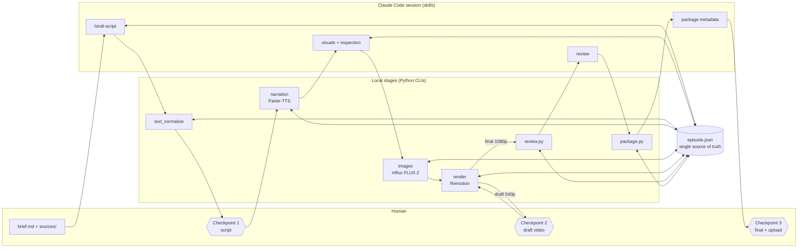
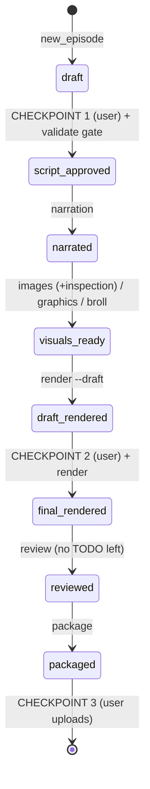

# AgriGate Hindi Video Pipeline: Technical Architecture

> **Audience:** engineers (and Claude sessions) who will maintain or extend this pipeline.
> **Status:** v0 complete (2026-11-19); visual upgrade phase A (shots + recurring cast) done; `episodes/2026-11-20-mitti-ki-jaanch-v3` (v2 script with cast shots) draft approved at checkpoint 2 on 2026-11-20, final render not started. The story-led pilot `episodes/2026-11-19-ramesh-mitti-jaanch-pilot` was rejected (D28). Demo episode: `episodes/2026-11-19-mitti-ki-jaanch`.
> **Related docs:** `PROJECT_BRIEF.md` (original requirements), `CLAUDE.md` (rules every session follows), `docs/licenses.md`, `docs/timings.md`.

---

## 1. What this system does

It produces Hindi educational YouTube videos for North Indian farmers: an AI narrator explains a topic while the screen shows AI-generated photos with slow pan/zoom, simple animated graphics, Hindi captions and the AgriGate watermark.

Three design principles drive almost every decision below:

1. **Accuracy over automation.** Wrong advice about doses, dates or prices costs farmers money. Facts come only from source files, and the pipeline refuses to continue while any `[VERIFY: …]` marker remains.
2. **Human checkpoints.** A person approves the script, the draft video and the final package. Nothing can skip a checkpoint.
3. **Every stage is swappable.** Each stage is a small CLI with a clear input/output contract and a backend chosen in `config.yaml`, so a stage can move to a paid API or AWS without touching the others.

An episode is produced **interactively in a Claude Code session**: Claude writes the script, picks and inspects visuals, runs the stages and reviews output. The heavy media work (TTS, image generation, rendering) runs **locally on a MacBook Air M5 (16 GB, fanless)**.

---

## 2. Big picture



**`episode.json` is the single source of truth.** Every stage reads it and writes its results back. All other files in the episode folder (`script.md`, audio, images, renders, review sheets, `youtube.md`) are derived from it or referenced by it.

---

## 3. Repository layout

```
agri-video/
├── PROJECT_BRIEF.md         original requirements (v0 build + v1 plan)
├── CLAUDE.md                rules loaded into every Claude session
├── README.md                setup + how to make an episode (for humans)
├── config.yaml              ALL tunable settings and backend choices
├── pronunciation.yaml       word → spoken form fixes for TTS (DAP → डी ए पी)
├── pyproject.toml / uv.lock main Python env (Python 3.12, pydantic, pyyaml, pillow)
│
├── pipeline/                one module per stage; each is `python -m pipeline.<stage>`
│   ├── schema.py            pydantic model of episode.json (+ status enum)
│   ├── common.py            config, paths, atomic save, log.md timing, CLI args, timing math
│   ├── new_episode.py       create an episode folder from templates/
│   ├── validate.py          schema + [VERIFY] + sources + length + stage-completeness gates
│   ├── text_normalize.py    narration_display → narration_spoken (numbers, units, pronunciations)
│   ├── prosody.py           delivery markup (| || {style}), sentence segments, automatic styles
│   ├── take_scoring.py      Whisper + pitch metrics → score and rank TTS takes
│   ├── tts_backends.py      TTS backend interface: parler (subprocess), stub
│   ├── narration.py         TTS per sentence × N takes → pick best → join with pauses → loudness → captions
│   ├── captions.py          caption chunking + timing
│   ├── audio.py             ffmpeg/ffprobe helpers (duration, trim, loudness, gain)
│   ├── tts_try.py           voice auditions / TTS smoke tests outside an episode
│   ├── cast.py              recurring characters: candidates, user-approved reference, prompt preamble
│   ├── images.py            image backend (mflux; edit mode for cast shots), shots, attempts, seeds, crops, inspection records
│   ├── broll.py             optional B-roll library: index / check / list
│   ├── render.py            sync assets into Remotion, write props, run remotion render
│   ├── review.py            contact sheets + automated checks → review/review.md
│   └── package.py           thumbnail (Remotion still) + youtube.md
│
├── tts-mlx/                 ISOLATED env for the production voices (mlx-audio, mlx-lm, snac)
│   ├── mlx_worker.py        any mlx-audio model (Maya2 Native, Chatterbox) — JSON in/out like parler_worker
│   ├── snac_lm_worker.py    Llama + SNAC-token models mlx-audio lacks (Veena; Indic-Speak with vocos_decoder.py)
│   └── vocos_decoder.py     vendored Indic-Speak decoder, loaded weights-only
├── tts/                     ISOLATED env for Parler-TTS (pins transformers==4.46.1)
│   ├── pyproject.toml
│   └── parler_worker.py     reads jobs as JSON on stdin, loads model once, writes WAVs
├── asr/                     ISOLATED env for take scoring (mlx-whisper, librosa)
│   └── asr_worker.py        transcribes takes, measures pitch range / end rise / gaps
│
├── remotion/                TypeScript video compositions (Remotion 4.0.545, React 19)
│   ├── src/Root.tsx         compositions: Episode, EpisodeShort (preview), FontTest, Thumbnail
│   ├── src/Episode.tsx      scenes in a TransitionSeries + overlays + audio
│   ├── src/scenes/          KenBurnsImage, BrollClip, TitleCard, KeyPoints, BigNumber, GraphicBackground
│   ├── src/overlays/        Captions, OnScreenText, Watermark
│   ├── src/theme.ts         landscape + portrait themes, brand colors, sizes, margins
│   ├── src/timing.ts        scene/episode frame math (mirrored in pipeline/common.py)
│   ├── src/types.ts         TS mirror of pipeline/schema.py
│   ├── src/fonts.ts         local Noto Sans Devanagari loading with delayRender
│   ├── public/fonts/        NotoSansDevanagari variable font + OFL.txt (committed)
│   └── public/{episodes,brand,broll,test}/   synced/generated at render time (gitignored)
│
├── .claude/skills/          Claude Code skills = the "how-to" for each stage
│   ├── make-episode/        orchestrator: stage order, checkpoints, status flow
│   ├── hindi-script/  narration/  visuals/  render/  review/  package/  index-broll/
│
├── assets/
│   ├── brand/               logo.png + brand.json (colors sampled from the logo)
│   ├── cast/<id>/           recurring characters: character.json + ref.png (committed), candidates/ (gitignored)
│   ├── broll/               OPTIONAL library: clips/, frames/, index.json
│   └── music/               (v1) royalty-free tracks
│
├── templates/episode/brief.md
├── episodes/<YYYY-MM-DD>-<slug>/   one folder per episode (see §5)
├── docs/                    ARCHITECTURE.md (this file), licenses.md, timings.md
├── samples/                 voice auditions, test images (gitignored)
└── tests/                   pytest suite (65 tests) + fixtures/sample-episode
```

### 3.1 Five runtimes, deliberately separated

| Runtime | Where | Why separate |
|---|---|---|
| Main Python env (3.12) | `.venv` via `uv sync` | Pipeline logic; light dependencies (pydantic, pyyaml, pillow). |
| TTS MLX env (3.12) | `tts-mlx/.venv` via `uv sync` in `tts-mlx/` | Production voices on Apple Silicon (MLX). mlx-audio pins a recent transformers; separate from Parler's pinned one. |
| TTS Python env (3.12) | `tts/.venv` via `uv sync` in `tts/` | `parler-tts` pins `transformers==4.46.1` and pulls torch; keeping it isolated stops it from constraining the main env. Called as a **subprocess** with JSON in and out. |
| ASR Python env (3.12) | `asr/.venv` via `uv sync` in `asr/` | mlx-whisper pulls torch, numba and MLX; only needed to score narration takes. Subprocess, JSON in and out. |
| mflux | `uv tool install mflux==0.24.0` (per user, `~/.local/bin`) | A CLI tool with its own MLX/torch stack, called as a subprocess. |
| Node / Remotion | `remotion/node_modules` | Rendering in headless Chrome; TypeScript compositions. |

System tools: `ffmpeg`/`ffprobe` from Homebrew. **This build has no `drawtext` filter** (no freetype), so text on frames is drawn with Pillow (contact-sheet timestamps) or Remotion.

---

## 4. Data model: `episode.json`

Defined in `pipeline/schema.py` (pydantic v2, `extra="forbid"` so typos in hand-edited JSON fail loudly), mirrored in `remotion/src/types.ts`. **Change both together.**

```jsonc
{
  "schema_version": 2,                // v1 files migrate on load (single image → shot 1)
  "id": "2026-11-19-mitti-ki-jaanch",
  "title_hi": "मिट्टी की जांच क्यों और कैसे कराएं",
  "status": "packaged",               // see §6.1
  "cast": ["ramesh", "sunita"],       // recurring characters in this episode (assets/cast/), main first
  "format": "long",                   // long (16:9) | short (9:16); must match video size
  "video": { "width": 1920, "height": 1080, "fps": 30 },
  "voice": { "preset": "rohit", "backend": "parler", "speaker": "Rohit",
             "description": "{speaker}'s voice is calm and clear…", "seed": 42, "wpm": 171 },
  "scenes": [{
    "id": 7, "purpose": "explain",     // hook|problem|explain|step|mistake|recap|cta
    "narration_display": "…",          // shown in captions; digits allowed
    "narration_spoken": "…",           // sent to TTS; numbers as words, pronunciations applied
    "on_screen_text": "…",             // optional 1–4 word tag (top-left)
    "visual": {
      "type": "image",                 // image | broll | graphic
      "shots": [{                      // image: 1–3 stills, each starting at a narration sentence
        "at_segment": 0, "characters": ["ramesh"],
        "image_prompt": "…", "seed": 133830, "attempts": 3, "image_file": "images/scene-07-s1.png",
        "reference_sha1": { "ramesh": "…" },   // reference used; a changed reference makes the shot stale
        "inspection": { "file_sha1": "…", "passed": true, "notes": "…; identity: …", "inspected_at": "…" } }],
      "broll_id": null, "in_sec": null, "out_sec": null,          // broll only
      "template": null, "props": null,                            // graphic only: TitleCard|KeyPoints|BigNumber
      "notes": null
    },
    "sources": ["sources/shc-faq-english.pdf#how-can-a-farmer-use-SHC"],
    "audio": { "file": "audio/scene-07.wav", "duration_sec": 12.102,
               "segments": [{ "text": "…", "start": 0.06, "end": 4.9, "style": "neutral" }],   // per sentence
               "words": [{ "text": "रिपोर्ट", "start": 0.06, "end": 0.48, "segment": 0, "timed": true }] },  // per displayed word (§7.4a)
    "captions": [{ "text": "रिपोर्ट में लिखा होता है कि", "start": 0.0, "end": 1.9,
                   "words": [{ "text": "रिपोर्ट", "start": 0.06, "end": 0.48 }] }]   // words: highlight (§7.5)
  }],
  "package": { "youtube_title": "…", "description_hi": "…", "tags": [], "thumbnail_text": "…",
               "thumbnail_image": "images/scene-07.png", "sources_list": [], "synthetic_content": null }
}
```

Model-level validators: scene ids are unique and ordered; shots start at segment 0 and their `at_segment` values increase; captions have `end > start`; B-roll `out_sec > in_sec`; `format` matches orientation (portrait ⇔ short).

**Writes are atomic** (`common.write_json`: write to a temp file, then `os.replace`), and `save_episode` re-validates before writing, so a crash never leaves a half-written `episode.json`.

---

## 5. Episode folder

```
episodes/2026-11-19-mitti-ki-jaanch/
├── brief.md             topic, angle, crop, region, season, format, source notes
├── sources/             source files + README.md (what each is, URL, conflicts found)
├── script.md            readable table for checkpoint 1 (generated from episode.json)
├── episode.json         single source of truth
├── audio/
│   ├── takes/<hash>.wav + .json   every TTS take (hash of text+style+seed) + metrics (what Whisper heard, pitch, gaps)
│   ├── segments/scene-XX.json     per scene: segments, style, all take scores, auto pick, manual override
│   ├── takes.md                   readable report of every take and score
│   ├── raw/scene-XX.wav + .json   scene mode (v0) only: one TTS call per scene
│   ├── work/scene-XX.wav          48 kHz, trimmed, compressed, segments joined with pauses (float32)
│   └── scene-XX.wav               final, loudness-normalized + room tone (16-bit)
├── images/
│   ├── scene-XX-sK-aN.png         every attempt of shot K kept (v1: scene-XX-aN.png)
│   ├── scene-XX-sK.png            current pick of shot K (what is rendered)
│   └── inspect/                   zoomed crops for inspection (gitignored)
├── render/              draft.mp4, video.mp4, thumbnail.png, props.json, thumbnail-props.json
├── review/              sheet-NN.png, checks.json, review.md
├── youtube.md           title, description, tags, upload checklist
└── log.md               append-only: every stage's duration, outcome, notes, checkpoint decisions
```

Media folders are gitignored; the text files (brief, sources README, script, episode.json, log, review.md, youtube.md) are the reviewable history.

---

## 6. Control flow

### 6.1 Status machine and gates



- **Status only advances through `validate --set-status <s>`**, which validates *at the target level* first and writes the status only if that passes. Nobody edits `status` by hand.
- `validate` is **cumulative**: checking at level *L* runs every check up to *L*:

| Level | Checks added |
|---|---|
| always | schema; **no `[VERIFY` anywhere** in episode.json or script.md; ≥1 scene; word count vs. target (from voice wpm × format seconds); hook first, CTA last with the config CTA line; scene length 4–14 s (estimated); factual scenes (`problem/explain/step/mistake`, or any scene with a digit) list sources; source files exist; on-screen text ≤4 words |
| `script_approved` | `narration_spoken` filled, no digits left; warns on Latin letters (TTS may mispronounce) |
| `narrated` | every scene has audio + captions; captions don't run past audio |
| `visuals_ready` | cast members have an approved, unchanged reference; image scenes: per shot prompt, seed, file exists, cast shots made from the current reference, **passing inspection of the current file (SHA-1 match)**; shot length 2.5–9 s (warning); B-roll: clip in index, complete and licensed, in/out within the clip, no reused segment, people-visible warning; graphics: template + props |
| `draft_rendered` / `final_rendered` | `render/draft.mp4` / `render/video.mp4` exist |
| `reviewed` | `review/review.md` exists with **no TODO** |
| `packaged` | `render/thumbnail.png` and `youtube.md` exist |

- Stage-level gates: `narration` refuses unless the status is ≥ `script_approved`; `render` needs `visuals_ready` for a draft and `draft_rendered` for a final. `--allow-unapproved` exists **only for pipeline tests** (used for the `phase5-test` episodes, never for real ones).
- In practice the **auto-mode permission classifier also blocked Claude from running `--set-status script_approved` on its own**. Approval stays with the human.

### 6.2 Idempotency and per-scene reruns

Every stage skips outputs that already exist unless `--force`, and takes `--scene N` (repeatable) to redo one scene:

- **narration** caches raw TTS per scene with a sidecar hash of (text, backend, model, description, seed). Changing a scene's text or the voice re-synthesizes only that scene. Trim, loudness and captions are always recomputed for the whole episode (≈11 s), because loudness is an episode-level property.
- **images** keeps every attempt; `--retry` makes the next attempt with a new deterministic seed; `--force` redoes the current attempt with the same seed; `--use-attempt N` switches back to an earlier one.
- **render** skips if the output is newer than `episode.json` (use `--force`).

### 6.3 Logging

`common.stage_timer(ep_dir, stage)` wraps each stage and appends to `log.md` its start time, duration, outcome (including failures and exit codes) and the notes the stage recorded. Checkpoint decisions and user notes are appended to the same log. `docs/timings.md` is compiled from these logs.

---

## 7. Stages in detail

### 7.1 `new_episode`
`python -m pipeline.new_episode <slug> [--format long|short] [--voice rohit|aman] [--date] [--topic] [--title-hi]`
Creates `episodes/<date>-<slug>/` with subfolders, `brief.md` (from `templates/episode/brief.md`), `log.md`, and an `episode.json` whose **video size comes from the format** and whose **voice is copied from the preset**. Copying the voice means an episode keeps its voice even if `config.yaml` changes later. Idempotent; the slug must be lowercase latin words joined by `-`.

### 7.2 Script (Claude, `hindi-script` skill)
- Claude reads `brief.md` and **every** source, writes scenes into `episode.json` and a readable `script.md` table (narration, visual idea, sources per scene).
- Structure: hook (≤10 s) → problem → explain → steps → mistakes → recap → CTA (`config.yaml: script.cta_hi`). Shorts: hook → one tip → one mistake → CTA.
- Language: spoken Hindi (बोलचाल की हिंदी), farmer terms (यूरिया, DAP, स्प्रे). Chemicals: always a "read the label, ask your KVK" line; no brands.
- **Unsupported specifics become `[VERIFY: …]`.** With no sources, factual scenes fail the source check. This is intended: the demo episode first stopped here with 57 errors, then Claude fetched official documents (Ministry SHC FAQ, PIB factsheets, ICAR-CCARI) into `sources/`, recorded conflicts in `sources/README.md` (e.g. ₹190 vs. ₹300 per sample), and rewrote the script around what the documents actually say.
- Sources are cited per scene as `sources/<file>#<anchor>`. The anchor is a human hint (page or section); only the file part is checked.

### 7.3 `text_normalize`
`narration_display` (captions) → `narration_spoken` (TTS). Order matters:

1. Devanagari digits → ASCII digits
2. `pronunciation.yaml` overrides, whole-word, longest first (`DAP → डी ए पी`, `KVK → के वी के`, `pH → पी एच`, `EC → ई सी`, `V → वी`)
3. currency: `₹2,500 → दो हज़ार पाँच सौ रुपये`
4. ranges: `10-12 → दस से बारह`, `2.5-3 → ढाई से तीन`
5. percent: `25% → पच्चीस प्रतिशत`
6. units after numbers: `kg/किग्रा → किलो`, `सेमी/cm → सेंटीमीटर`, `ml → एम एल`, `°C → डिग्री सेल्सियस` …
7. remaining numbers → words in the Indian system (हज़ार/लाख/करोड़), with **colloquial fractions**: 0.5 आधा, 1.5 डेढ़, 2.5 ढाई, x.5 साढ़े x, 1.25 सवा, x.25 सवा x, x.75 पौने (x+1); other decimals "दशमलव …"
8. `/` → `प्रति` **only right after a unit** (`किलो/एकड़ → किलो प्रति एकड़`; `लैब/योजना` stays)

0–99 use an explicit table, because Hindi number words are irregular. `--text "…"` normalizes a single string, which is handy when checking a new pronunciation.

### 7.4 `narration`
Two modes (`config.yaml: narration.mode`). **`segments`** (default since 2026-11-19) aims at delivery that sounds like a person explaining, not a model reading a paragraph. **`scene`** is the v0 path (one TTS call per scene), kept for A/B comparison.

```mermaid
sequenceDiagram
    participant N as narration.py
    participant P as prosody.py
    participant W as tts/parler_worker.py
    participant A as asr/asr_worker.py
    participant F as ffmpeg
    N->>P: split display + spoken into segments (। ? ! | ||), pair them 1:1
    P-->>N: segments + pause after each + style (explicit {style} or auto)
    N->>W: N takes per segment (seed = voice seed + k, description = style), cached by hash
    N->>A: unscored takes → what Whisper heard, pitch range, end rise, longest gap
    N->>N: take_scoring: rank takes per segment; --pick overrides (kept while text unchanged)
    N->>F: picked takes: trim, compress, fade, tempo; join with pauses_sec
    N->>F: ONE episode gain (+ limiter) and quiet pink room tone
    N->>N: duration, audio.segments, per-segment captions → episode.json; takes.md report
```

- **Why sentences?** Parler flattens and rushes long inputs and invents its own pause lengths. Short inputs are cleaner, and we control the gaps: comma pauses stay with the model; sentence, question, `|` and `||` pauses come from `narration.pauses_sec`.
- **Delivery markup** in the script (`hindi-script` skill): `|` breath, `||` long pause, `{slow|warm|firm|question}`. Stripped for captions, word counts and validate checks. Automatic styles: questions → `question`, numbers on screen → `slow` (and tempo 0.97), CTA → `warm`, mistakes → `firm`. After a `|` the sentence keeps its style. Styles are Parler descriptions that keep the speaker name. The model card lists pitch, speed, expressivity and recording quality as controllable; emotions are untested for Hindi.
- **Best of N takes.** Different seeds give different prosody, and occasionally a wrong word or babble at the end. Scores rank takes **within one segment** (`take_scoring.py`): character error vs. the script after normalizing both (numbers → words, `pronunciation.yaml`, no nukta or punctuation, so Whisper's spelling quirks cost every take equally), length far from the takes' median (babble or skipped words), pitch range in semitones (monotone loses, capped), mid-sentence gaps, the end rise for questions, **register**: distance from the typical pitch of the take's style (questions are meant to sit higher, e.g. 167 Hz vs. 130 Hz neutral for Parler; a style may sit at most 3 semitones from the voice), and **identity**: distance from the episode's overall voice pitch beyond 4 semitones, heavily penalized, because that is effectively another speaker (Veena drifts from ~230 Hz to ~120 Hz in about 1 take in 5). Accuracy outweighs every pitch preference except identity. Picks with error > 0.12 are listed to listen to.
- **Clean joins** (`audio.clean_take`): TTS takes end (and sometimes start) with a short non-speech burst (Maya2/Mimi: 20–30 ms at about −40 dB after the speech; Parler: a one-window blip). A threshold trim kept it and the join cut it off, so every junction had an audible disturbance. Now speech is found from a 10 ms envelope (within 40 dB of the loudest window). Edge islands are dropped when they are short (< 60 ms), or when they run into the very edge of the file after a gap and are < 200 ms: Maya2 often ends a take with 70–80 ms at about −30 dB, still loud at the last sample, while real speech decays. 40 ms of room is kept before and 90 ms after the speech, **never reaching into a dropped burst**, and raised-cosine fades (15 ms in, 60 ms out) end at true silence. Checked on the v2 soil draft: no blips at any join, and every scene's last word intact (Whisper).
- **Room tone:** one continuous track (`audio/room-tone.wav`, a 30 s seamless loop of pink noise, 80 Hz–7 kHz, exactly −66 dBFS RMS) played looped under the whole video by `Episode.tsx`, fading in and out with the video. It used to be mixed into each scene file, which switched the hiss on and off at every scene change.
- **Caching:** takes are keyed by (text, backend, model, description, seed); metrics by the ASR backend. Editing a sentence re-synthesizes only that sentence's takes. Loudness, joins and captions are always recomputed for the whole episode.
- **Backend contract:** `synthesize(text, voice_cfg, out_path) -> duration_sec`, plus optional `synthesize_many(jobs)`; a `TTSJob` may carry its own `description` and `seed`. Backends: `parler`, `stub` (sine tone; with stub the ASR step is skipped). Other open models will be compared through the same contract.
- **Why one gain for the whole episode?** Per-scene normalization would make quiet scenes as loud as emphatic ones. One gain keeps relative levels natural while hitting −14 LUFS. The 3:1 compressor stops Parler's peaks from making the limiter eat loudness.
- After running, it lists scenes to check by ear plus flagged segments, and writes `audio/takes.md`. Nothing plays automatically.

### 7.4a Word timing (`pipeline/word_align.py`, 2026-11-20, visual upgrade phase B1)
After the loudness pass, each final scene wav goes to the `asr/` worker with `words: true`: Whisper large-v3-turbo with word timestamps, **the script as `initial_prompt`** (so it spells words the way the script does; scoring jobs never get a prompt, so slips are still caught), plus the wav's silent runs (≥ 80 ms, 35 dB below the loudest frame). Raw output is cached in `audio/words/scene-XX.json`, keyed by the wav bytes, prompt and settings. `narration --align-only` redoes just this step for an already narrated episode (~30 s for a 4-min episode; a cached re-run is instant).

Then, in the main env:
1. **Snap to speech.** Whisper starts a word that follows a pause inside the silence (measured 0.2–0.3 s early after commas) and lets words run into the next pause. A start inside a silence, or up to 50 ms before one, moves to where speech resumes; an end inside one moves to where it began.
2. **Align letters, not words.** Script words and heard words are reduced to `canon()` letters (as in take scoring: numbers → words, nukta and nasal marks unified) and aligned with difflib. A script word takes Whisper's time if ≥ 40% and ≥ 2 of its letters matched, using the heard word's own edges unless another script word shares that heard word. Unmatched words are spread by letter count between their timed neighbours.
3. **Clamp to the sentence span.** Each word stays inside its segment's speech span, which the narration stage knows exactly because it joined the takes. A segment with < 60% of its letters matched falls back to proportional timing (`timed: false`).

Measured on `2026-11-20-mitti-ki-jaanch-v3` (23 scenes, 44 sentences, 637 words): all words matched (without the prompt, two sentences dropped to 66%); sentence starts median 0 ms / p90 70 ms off the known span; at the 70 pauses inside sentences, the next word starts within one frame (40 ms) of the voice resuming in 61 cases (11 before snapping), p90 122 ms, max 0.4 s. Most of the remaining cases are a consonant closure inside a word (इस्तेमाल, कितनी), not a pause. Settings: `config.yaml: narration.word_timing`.

### 7.5 `captions`
Chunks come from `narration_display` (what is shown, markup removed). In segments mode each sentence's chunks are timed **inside that sentence's real audio span**, and a caption stays up through the following pause. In scene mode they are spread across the scene. Within a span, timing is **in proportion to character count**:
1. split at clause punctuation `। ? ! , ; : —`
2. split clauses longer than `max_words` (6 for long, 4 for Shorts) at the **best boundary**, scored as: closeness to an even split, +3 if the chunk ends on a postposition, auxiliary or conjunction (में से के है और …), +2 if the next chunk starts with a phrase opener (और कि कौन …), −5 if it ends on a phrase opener (कौन, बिना, हर …), −4 if the next word is a postposition
3. fold 1–2-word fragments into a neighbour; a lone word may push a chunk to `max_words + 1`, so lists like "ज़िंक, आयरन, कॉपर," never flash a single word

These heuristics came from real defects ("कौन | सा", "बिना | जांच", "पोषक | तत्व", a lone "कॉपर,"), each now a regression test.

**Word-timed captions** (phase B2, 2026-11-20; `captions.word_captions`). When the scene has `audio.words`, the same chunks are timed from their words: a chunk appears `captions.lead_sec` (0.1 s) before its first word, never before the previous chunk, and stays up until the next chunk appears (through pauses, so nothing flickers); the last stays to the end of the audio. Each caption carries its words. If the words don't match the text (narration edited after word timing), the scene keeps character-proportional captions and `validate` warns. `narration --align-only` rebuilds the captions too.

**Word highlight** (user choice 2026-11-20). `Captions.tsx` draws the word being spoken in the brand green (`theme.colors.captionHighlight`, #3fb660). A word is lit from its start until the next word starts, but at most `captions.highlight_hold_sec` (0.25 s) past its own end, so comma and sentence pauses show no highlight. Only the colour changes (no bold or scale), so the line never reflows. Switch: `captions.highlight_words`.

### 7.6 `images` (and the inspection gate)
- **Backend:** `mflux-generate-flux2` running **FLUX.2 [klein] 4B, pre-quantized 4-bit** (`mflux-community/flux2-klein-4b-mflux-q4`), 4 steps, guidance 1.0. About 18–22 s per image including model load; peak ≈3.7 GB RAM.
- **Size by format:** 1344×768 (long) or 768×1344 (short), multiples of 16. Remotion scales to cover the frame, and the slow zoom hides the upscaling.
- **Prompt** = scene prompt + `images.style_suffix` ("…, no readable signs, no captions, no watermark": it asks for no readable text, but doesn't push the model toward blank paper or bare walls). Prompts must be concrete about people, clothing, crop **and stage**, the tool and grip, what **both hands** are doing, and the setting.
- **Seeds:** `sha1(episode_id:scene_id:attempt)`, deterministic, so reruns reproduce and retries differ. Stored per scene.
- **Attempts:** each saved as `scene-XX-aN.png`. After `max_attempts` (3) the stage writes a **FLAG** to `log.md` instead of generating more; `--extra-attempt` exists only for when the user explicitly asks for another try.
- **Inspection** (mandatory and enforced):
  1. look at the full image, then `--crops`, which writes four 2× quarter crops to `images/inspect/`;
  2. go person by person through `images.inspection_checklist` in `config.yaml`: 2 arms and 2 hands, **both visible**; hands of **different people never fused**; 5 fingers; 2 legs; possible posture; correct dress; tools with one handle, held properly; natural faces; Indian context; **no readable text (illegible incidental text is wanted)**;
  3. record it: `--inspect pass|fail --notes "<what was counted>"`. A pass without notes is rejected.

  The record stores the image's **SHA-1**: regenerating or swapping the image invalidates it automatically, and `validate` blocks `visuals_ready` until every image scene has a passing record.
- **Local post-edits** (e.g. blurring a legible poster header or a small portrait) are allowed; they change the SHA-1, so the image must be re-inspected, and the edit is mentioned in the notes.

### 7.6a Shots and the recurring cast (2026-11-19)
- **Shots.** A scene held one still for 10–17 s, which felt static. An image scene now holds 1–3 `shots`, each starting at a narration sentence (`at_segment`). The cut sits in the middle of the pause before that sentence (`common.shot_starts_sec` = `timing.ts: shotStartFrames`); without segment timings, shots split the scene evenly. Each shot gets its own Ken Burns move, and the next shot dissolves in over `SHOT_FADE_FRAMES` (6). Validate warns for shots under 2.5 s or over 9 s.
- **Cast.** Recurring synthetic characters live in `assets/cast/<id>/` (`schema.CastMember`: name_hi, name_en, role, gender, `look`, `wardrobe`). `cast candidates` makes 4 full-figure references (plain wall, final costume, face sharp). Claude inspects them, `cast sheet` makes a numbered sheet, **the user picks**, and `cast approve` records the file's SHA-1.
- **Consistency mechanism.** A shot with `characters` runs `mflux-generate-flux2-edit` (same FLUX.2 klein 4B q4, Apache-2.0) with the reference images, and the prompt starts with `cast.reference_preamble()`: "<Name> is the man in reference image 1: keep exactly his face … and his clothes (<wardrobe>); nothing else added on the head." Tests (`samples/character-test/`): the face, hair and beard carried over well across field, close-up and lab shots, and two characters with two references stayed distinct. Klein takes clothes from the **prompt** more than from the reference and adds headwear on its own, hence the explicit wardrobe and "nothing added". Cost: ~40 s per shot with one reference, ~90 s with two (vs ~19 s).
- **Identity inspection.** `--crops` also writes `<shot>-vs-<id>.png` (reference | shot). Checklist item "Identity"; `--inspect pass` on a cast shot requires the notes to mention identity. Each shot stores the reference SHA-1 it was made from, so re-approving a reference flags every older shot.
- **Action & physics inspection** (D29). Every pass note needs `action: ...`: poured/thrown material traced to an open hand or tilted container, landing that matches the action, nothing floating; plus a narration & good-practice check (crop stage, method, quantity, clean equipment). `images.pass_notes_problem` refuses passes without it; `validate` errors on any inspection recorded from `ACTION_RULE_SINCE` (2026-11-20) without it. If the model cannot draw a step correctly after its attempts, drop the shot or use a graphic rather than keep a misleading picture.
- Fallbacks if references stop being enough: a second, close-up face reference per character; a character LoRA (`mflux-train` on klein base 4B, larger download). Face swap (InsightFace) is excluded: non-commercial.

### 7.7 B-roll (optional)
The library lives in `assets/broll/`. `broll index` probes new clips (duration, size, fps, orientation), writes a three-frame contact strip to `frames/<id>.jpg`, and adds a **stub** entry. Claude then fills in descriptions (English and Hindi), tags (crop, activity, setting, season, shot type), usable segments, quality notes, `people_visible`, source and **license**. A clip with any field missing is **unusable**: `broll check` fails, `validate` rejects it, and `list` marks it. Most episodes use generated images only; the visuals skill skips B-roll entirely when no complete clips exist.

### 7.8 `render`
1. Validate at `visuals_ready`.
2. **Sync assets** into `remotion/public/` using **hard links** (no extra disk, falls back to copy): only this episode's audio and images (other episodes' synced folders are removed so the Remotion bundle stays small), the B-roll clips it uses, and the logo.
3. Write `render/props.json`: `{episode, assetBase, brollBase, brollFiles, paddingSec, logo, captionFontSize}`.
4. `npx remotion render src/index.ts Episode <out> --props=… --concurrency=4 --hardware-acceleration=if-possible --codec=h264 --audio-codec=aac [--scale=0.5]`.
5. Compare the output duration with `common.episode_frames` (warn if off by >0.15 s).

**Timing model** (implemented twice, kept in sync: `remotion/src/timing.ts` and `pipeline/common.py`):
`scene_frames = max(round((scene_lead_in_sec + audio_sec + scene_padding_sec) × fps), 2×crossfade+1)` and
`episode_frames = Σ scene_frames − crossfade × (n−1)`, with `crossfade = 10` frames (`config.yaml: render.crossfade_frames` = `TRANSITION_FRAMES` in `theme.ts`). In `Episode.tsx` the scene's audio and captions sit in a `<Sequence from={leadIn}>`, so **the new picture lands before the voice**. With padding 0.8 s and lead-in 0.4 s, a scene change is ≈1.0 s of silence (measured on the v2 soil draft: 0.91–1.01 s), against a median 0.35 s and max 0.60 s inside scenes. Before (padding 0.35 s, no lead-in) it was ~0.15 s, shorter than a full stop, and scenes ran together (user feedback, D24).

### 7.9 Remotion compositions
- **Episode** (`Episode.tsx`): a `TransitionSeries` of scenes with `fade()` transitions. Each scene renders its **visual** (`KenBurnsImage`, `BrollClip`, or a graphic: `TitleCard`, `KeyPoints`, `BigNumber`, with a "pending" title card fallback), then `OnScreenText` (top-left tag), `Captions` (bottom, ≤2 lines with a clamp safety net), and its `<Audio>`. The `Watermark` sits on top for the whole video. Width, height and duration come from props via `calculateMetadata`, so **one composition renders both 16:9 and 9:16**.
- **Graphics on cue** (phase B3, 2026-11-20; `pipeline/cues.py`): `render.py` resolves, per graphic scene, when each **KeyPoints** point and the **BigNumber** number should appear and passes `graphicCues` (narration seconds) + `cueLeadSec` (0.15 s, `graphics.cue_lead_sec`). Cues are found from the words the narrator says: the point's meaningful words (small words like से/के/और ignored) are matched **in order** against `audio.words` after the previous cue, as `canon()` letters (so "3" ↔ "तीन", "2.5–3" ↔ "2.5-3") or a shared 4-letter stem (सुखाएं ↔ सुखाकर); the tightest best window wins, and the cue is its first matched word. In-order matching was needed because repeated words ("…के पास, पेड़ या कुएं के पास") otherwise pulled a point back onto the previous one. Explicit `props.cues` / `props.cue` (phrases from `narration_display`) override; an explicit cue not found is a `validate` error, an automatic miss a warning and the old timing (points over the first 60%, the number at once). KeyPoints: the title shows at once, each point slides in at its cue, never before the previous one. BigNumber: the label shows first with the number's space reserved, and the number pops when spoken. On v3 all 17 cues landed on the right word (e.g. scene 6: नाइट्रोजन 3.96 s, ज़िंक 7.85 s, pH 13.9 s; previously all three points were up by 9.7 s). TitleCard and the on-screen tag still appear at the scene start: they name the scene's topic.
- **KenBurnsImage:** zoom 1.02↔1.12 with a pan bounded by the zoom margin, so edges never show. Direction is chosen deterministically from the scene id, so renders are reproducible.
- **Themes** (`theme.ts`): `landscapeTheme` and `portraitTheme`, picked by `useTheme()` from the frame size. Portrait keeps captions and graphics above the bottom ~25% and leaves a right gutter for the Shorts UI. Colors come from the logo (#3fb660, #0a6132).
- **Fonts:** variable Noto Sans Devanagari, bundled locally (no network), loaded through the `FontFace` API inside `delayRender`, so no frame renders with a fallback font. Verified with the `FontTest` still (क्षेत्र, श्रमिक, द्वारा, कृषि, ज़्यादा, प्रधानमंत्री, ट्रैक्टर, plus Latin, ₹ and %).
- **Thumbnail** (`Thumbnail.tsx`): 1280×720 (long) or 1080×1920 (short). The image is darkened on the text side; a 3–5-word title takes ≤46% of the width, keeping it off the subject's face; brand pill. **No `-webkit-text-stroke`**: the variable font's overlapping contours draw lines inside the glyphs, so a text-shadow is used instead.
- `EpisodeShort` is a Studio-only preview with portrait test props; `npm run test-assets` makes placeholder media.

### 7.10 `review`
- Extracts a frame every 2 s (an ffmpeg `select` filter), stamps the time in the **bottom-left** with Pillow (keeping the tag, watermark and captions visible), tiles 12 per sheet (4×3 landscape, 6×2 portrait).
- **Automated checks:** duration vs. timing model, integrated LUFS and true peak, black segments (`blackdetect`), static stretches ≥4 s (`freezedetect`, info only, since graphic holds are legitimately static).
- Writes `review.md` with scene start times (to map a timestamp to a scene) and a manual checklist marked TODO. Claude completes it after looking at **every** sheet, extracting full-size frames for anything involving people. `validate` will not mark the episode reviewed while any TODO remains.

### 7.11 `package`
Claude writes `episode.package` (title < 70 chars, short Hindi description, ~10 tags, 3–5-word thumbnail text, thumbnail image, readable source names). `package.py` checks these fields, renders the thumbnail still, and writes `youtube.md`, appending the sources and the KVK disclaimer automatically. It adds `#Shorts` for short-format episodes and sets the **"Altered or synthetic content" disclosure to YES automatically whenever the video contains generated images**. Upload is manual in v0.

---

## 8. Claude's role and the skills

Skills in `.claude/skills/` tell Claude *how* to run each stage; the scripts hold the logic. `make-episode` is the orchestrator:

| Step | Skill | Ends with |
|---|---|---|
| 1 | `hindi-script` | draft → **checkpoint 1** → `script_approved` |
| 2 | `narration` | `narrated` (Claude lists files to listen to) |
| 3 | `visuals` | images generated **and inspected**, graphics filled, optional B-roll → `visuals_ready` |
| 4 | `render --draft` | `draft_rendered` → **checkpoint 2** |
| 5 | `render` (final) | `final_rendered` |
| 6 | `review` | `reviewed` |
| 7 | `package` | `packaged` → **checkpoint 3** |

Rules the orchestrator enforces: never skip a checkpoint ("just do everything" is not permission); at each checkpoint, name the exact file and what to look for; on failure, fix only that stage or scene; run heavy jobs one at a time; apply checkpoint notes scene by scene.

Claude-specific judgement steps (cannot be scripted): writing Hindi copy, resolving `[VERIFY]` against sources, writing image prompts, **inspecting every image** (anatomy, text, context), reviewing contact sheets, and writing YouTube metadata.

---

## 9. Configuration and options reference

### 9.1 `config.yaml`

| Key | Meaning |
|---|---|
| `video.fps`, `video.scene_padding_sec`, `video.scene_lead_in_sec` | 30 fps; silence after each scene's narration (0.8 s, the crossfade sits at its end); picture-before-voice at the start of each scene (0.4 s) |
| `formats.{long,short}` | `width/height`, `target_sec` (length range), `image_size`, `max_sec` (Shorts), `caption_max_words` (Shorts: 4) |
| `script.cta_hi`, `script.factual_purposes` | CTA line validate looks for; scene purposes that require sources |
| `tts.backend/model/seed/device/out_sample_rate` | Parler on MPS, seed 42, 48 kHz output |
| `tts.default_voice`, `tts.voices.<preset>` | presets with `speaker`, `wpm` (measured), `description` (`{speaker}` placeholder) |
| `audio.target_lufs/true_peak_db` | −14 LUFS, −1.5 dBTP |
| `narration.*` | `mode` (segments/scene), `takes` (a voice preset may override, e.g. Veena 6), `pauses_sec` per pause kind, `room_tone_db`, `styles` (Parler descriptions + tempo), `auto_style` rules, `asr` (whisper model), `score_weights` |
| `images.*` | backend, command, model, base_model, steps, guidance, quantize, `style_suffix`, `max_attempts`, **`inspection_checklist`** |
| `captions.max_words_per_chunk`, `captions.font_size_px` | 6 words per chunk (long default); caption size per format `{long: 56, short: 64}` px at full resolution, passed by `render.py` as the `captionFontSize` prop (falls back to the theme) |
| `render.*` | draft scale 0.5, concurrency 4, hardware acceleration, crossfade frames (must match `theme.ts`) |
| `review.*` | frame interval 2 s, 12 frames per sheet |
| `package.*` | thumbnail sizes per format, Hindi disclaimer |

`pronunciation.yaml`: whole-word replacements applied before number conversion.

### 9.2 CLI options

| Command | Options |
|---|---|
| `new_episode <slug>` | `--format long|short`, `--voice <preset>`, `--date`, `--topic`, `--title-hi`, `--force` |
| `validate <ep>` | `--as <status>` (check only), `--set-status <status>` (check, then advance) |
| `text_normalize <ep>` | `--scene N`, `--force`; or `--text "…"` |
| `narration <ep>` | `--scene N`, `--force`, `--takes N`, `--pick SCENE:SEG:TAKE`, `--mode segments|scene`, `--asr whisper|none`, `--rescore`, `--backend stub`, `--allow-unapproved` (tests only) |
| `tts_try` | `--voices <presets…>` or `--speakers <names…>`, `--text` (repeatable), `--description`, `--tag`, `--backend`, `--out` |
| `images <ep>` | `--scene N`, `--force`, `--retry`, `--prompt`, `--seed`, `--extra-attempt` (user-requested only), `--use-attempt N`, `--crops`, `--inspect pass|fail --notes`, `--checklist`; one-off: `--prompt --out --format` |
| `broll` | `index`, `check`, `list [--tag] [--orientation]` |
| `render <ep>` | `--draft`, `--force`, `--allow-unapproved` (tests only) |
| `review <ep>` | `--draft` |
| `package <ep>` | (reads `episode.package`) |

All episode commands accept `episodes/<id>`, `<id>`, or a path to `episode.json`.

---

## 10. Decision log

Decisions made during the v0 build, with what was considered.

| # | Decision | Alternatives considered | Why |
|---|---|---|---|
| D1 | **Remotion** for rendering, free individual license | Revideo, Motion Canvas (MIT) | Mature, React-based, good text and transitions. The company license is required if AgriGate (>3 people, for-profit) uses it commercially; the user chose the individual license for the current personal/educational phase. Recorded in `docs/licenses.md`. |
| D2 | **Indic Parler-TTS** in an **isolated env**, called as a subprocess | Same env; IndicF5; paid APIs | Apache-2.0, good Hindi, runs on MPS. Its `transformers==4.46.1` pin would constrain the main env. The JSON-over-stdin worker loads the model once per run. Needed `sentencepiece==0.2.0` (newer versions need protobuf ≥5, but descript-audiotools caps protobuf <5). |
| D3 | Voice **Rohit** at normal pace (~171 wpm) as default, **Aman** (~191 wpm) as a preset | Divya with a "slightly slow" description (~150 wpm, inside the brief's 130–150) | User preference after auditions. Consequence: length targets are computed from **seconds × measured wpm** instead of fixed word counts (D4). |
| D4 | Word targets = `format.target_sec × voice.wpm` | Fixed 400–650 words | At 171 wpm, 400–650 words is only 2.3–3.8 min; the real constraint is minutes. |
| D5 | **FLUX.2 [klein] 4B, 4-bit** via mflux | FLUX.1 schnell 8-bit (brief), schnell 4-bit, Z-Image-Turbo | schnell q8 is 18 GB and doesn't fit in 16 GB RAM; schnell q4 is 9.6 GB (over the 6 GB download limit). klein-4B q4 is 4.6 GB, Apache-2.0, ~3.7 GB peak, follows concrete prompts well. FLUX.1 dev, FLUX.2 klein 9B and flux-3 klein are non-commercial: **never use them**. schnell q4 is kept as a config fallback. |
| D6 | **Shorts (9:16) as a per-episode format** | Build only 16:9 (brief); re-cut Shorts from long videos (v1) | User request. Same pipeline and same composition with an orientation-aware theme; portrait image size; 4-word captions; Shorts UI safe zones. Re-cutting a long episode into a Short stays v1. |
| D7 | **B-roll optional**; generated images and graphics are the default | B-roll first (brief) | The user will rarely supply clips. The library tooling exists and enforces licenses, but the visuals skill skips it when empty. |
| D8 | **Mandatory image inspection, enforced by `validate`** with SHA-1-bound records | Trust Claude's judgement; review only at the end | Extra hands (scenes 4 and 20), fused hands between two people (scene 15), fused tools and fake text slipped through grid-based reviews. Grid thumbnails are too small to count fingers. The checklist grew from the user's notes (2 arms, hands and legs, 5 fingers, posture, dress, tool grip, separate people, both hands visible). |
| D9 | **Illegible incidental text is wanted**; only readable or focal text is a defect | "No text anywhere" (brief) | The user found bare lab walls and blank report sheets unnatural. Legible fragments (a poster header, a portrait photo) are softened with a local blur instead of regenerating. |
| D10 | Episode-wide single loudness gain + compressor + top-up loop | Per-scene `loudnorm` | Keeps natural relative levels and lands within ±0.5 LU of −14 LUFS. |
| D11 | Caption chunking heuristics (§7.5) | Even word split; word-level alignment (v1) | Even splits broke Hindi phrases; alignment is out of scope for v0. |
| D12 | Hardware (VideoToolbox) H.264 | x264 software | Same wall time (frame rendering is the bottleneck) but ~half the CPU, so less heat on a fanless Mac. Larger files (~13 Mbit/s), fine for YouTube. |
| D13 | Hard-link sync into `remotion/public/`, one episode at a time | Symlinks; copies; serving from `episodes/` | Remotion bundles `public/`; hard links cost no disk and keep the bundle small. |
| D14 | Pillow for frame annotations | ffmpeg `drawtext` | The Homebrew ffmpeg build lacks freetype/drawtext. |
| D15 | Status changes only via `validate --set-status` | Stages set status themselves | One place enforces the gates; checkpoints remain human decisions. |
| D16 | `episode.json` strict schema (`extra="forbid"`) + atomic writes | Loose dicts | Hand edits are common; typos must fail loudly; crashes must not corrupt state. |
| D17 | Thumbnail title ≤46% width, shadow not stroke | 62% width; text stroke | The title covered the farmer's chin; the stroke drew artifacts inside Devanagari glyphs. |
| D18 | Claude fetches official sources when the user has none | Leave `[VERIFY]`; trust user notes | User request (option B). Sources are saved with a README of URLs and **conflicts** (₹190 vs. ₹300; 2 vs. 3 years; 5 vs. 10–15 spots). Claims not found officially (e.g. "20–30 days before sowing") were dropped. |
| D19 | Caption size and prompt suffix aligned with config and the text rule (2026-11-19) | Leave `font_size_px` unused; keep "no text" | The config value was silently ignored, and "no text" contradicted D9. Both are now wired and tested (`test_phase5.py`). |
| D20 | **Sentence-level narration, N takes, Whisper-scored** (2026-11-19) | One TTS call per scene (v0); paid/expressive TTS; voice actor | User wants natural, human delivery and accepts long machine time; no paid APIs or actors. Splitting gives controlled pauses, per-sentence style and exact caption timing; takes trade compute for quality; Whisper catches slips (e.g. "खेट" for खेत) that a quick listen misses. Scores only rank takes of one sentence; the ear has the last word (`--pick`). |
| D21 | Isolated `asr/` env for scoring | Add mlx-whisper to the main or `tts/` env | It pulls torch, numba, MLX; the main env stays light and `tts/` keeps its pins. |
| D22 | **Production voices: Maya2 Native "Vasant" (male, default) and Veena "varun" (female)** (2026-11-19) | Parler Rohit (v0), Chatterbox Multilingual cloning a synthetic Rohit, Indic-Speak "Amit", other Maya2/Veena voices | User's choice after listening to the same 4 scenes from 5 models through the segments pipeline (`samples/narration-compare/`). Measured on the pilot: Maya2 0.9–1.0× realtime, mean take error 0.021 (best of all), ~174 wpm; Veena 4.7× realtime, mean take error 0.068 with voice drift handled by the identity score and 6 takes. Indic-Speak was the most accurate after picking (9/10) but 5.3× realtime and under a custom licence; Chatterbox needs a reference clip (synthetic only, CLAUDE.md). Excluded: Voxtral TTS, XTTS-v2, MMS (non-commercial), VibeVoice-Hindi-7B (community fine-tune, research-only advice, too big). Licences: `docs/licenses.md`. |
| D23 | Artifact-aware take trimming + long smooth fades (2026-11-19) | ffmpeg `silenceremove` + 8 ms fades | The user heard a disturbance at every sentence join; measurement showed codec bursts at take edges that the threshold trim kept and then cut abruptly. |
| D24 | Scene change ≈1 s: padding 0.8 s + 0.4 s picture-first lead-in (2026-11-19) | Only longer padding; a sound cue | The user couldn't hear where one scene ended and the next began. The longest pause should mark the biggest change of idea; showing the new picture before the voice is how editors signal a new topic. +~20 s per 4-minute episode. |
| D25 | Room tone as one continuous Remotion track; edge bursts cut even when long (2026-11-19) | Room tone per scene file; island length rule only | The user still heard disturbances at some joins in the v2 draft: per-scene room tone stepped from digital silence at each scene edge, and Maya2's 70–80 ms end-of-file bursts passed the 60 ms rule (and the 90 ms post-roll re-added shorter ones). |
| D26 | **Several shots per image scene**, cut on sentence boundaries (schema v2) (2026-11-19) | One image per scene with a longer Ken Burns move | A still held 10–17 s felt static; editors change the picture every 3–5 s. Sentence timings already exist from narration, so cuts fall in natural pauses. Roughly doubles image time. |
| D27 | **Recurring synthetic cast with user-approved references; FLUX.2 klein edit mode** (2026-11-19) | New random people per shot; character LoRA; face swap | User: the farmer on screen must look the same in every shot (the v2 soil video showed a different face and build each time). Edit mode needs no new model or licence and worked in tests; LoRA is the fallback; face-swap stacks are non-commercial. |
| D28 | **Informative narration; cast is visual only** (2026-11-20, replaces a story-led version of 2026-11-19) | Story-led: the narrator tells रमेश जी's story | The story-led pilot (82 s) dropped most of the content of the informative v2 episode (soil card parameters, quartering, labelling, all four mistakes, 3-year cycle). User: the goal was only consistent faces; the explainer format is what helps farmers. The narrator addresses the viewer; cast members demonstrate on screen and are not named. |
| D30 | **Word timing = Whisper word timestamps aligned to the script by letters, snapped to silences, clamped to sentence spans** (2026-11-20) | Forced alignment model (MMS/wav2vec2 CTC); trust Whisper's words directly; keep proportional timing | No new model or licence (mlx-whisper is already in `asr/`); measured accurate enough on v3 (§7.4a). The script is the truth for *what* was said, Whisper only for *when*; the known sentence spans bound any error. A CTC forced aligner stays the fallback if a voice or episode measures worse. |
| D31 | **Word-timed captions with a colour-only highlight of the spoken word** (2026-11-20) | Keep proportional timing; karaoke fill (spoken words stay coloured); bold/scale the current word | User chose the spoken word in brand colour. Colour only, so the line doesn't reflow; only the current word, so the viewer's eye is led to one place; unlit in pauses. Chunking unchanged, so the phrase-break fixes of §7.5 still hold. |
| D32 | **Graphics appear on cue, matched automatically from the point's words; explicit cue as override** (2026-11-20) | Fixed even schedule (v0); require a cue phrase for every point in the script | Points used to appear before the narrator reached them (scene 6 showed all 12 parameters while the voice was still at सल्फर). Automatic matching needs no script changes (all 17 v3 cues were right); explicit cues cover paraphrases the matcher can't place. Tags and title cards stay at scene start because they label the topic. |
| D29 | **Action & physics check on every image, enforced in code** (2026-11-20) | Limb/finger checklist only | At checkpoint 2 the user found a passed shot where khaad poured out of a closed fist gripping an upright bucket. User: make it a rule so it never repeats. The re-check of all 26 shots then caught a water-filled sampling bucket, steam from cold flasks, an oversized sample pit and a dirty 'clean bag'. |

---

## 11. Known limitations and gotchas

- **VS Code's video preview plays no AAC audio.** Renders look silent there; use QuickTime or VLC.
- **Image models struggle with two people interacting.** Hand-overs are the riskiest shot (fused or missing hands). Prefer compositions where people don't touch: a farmer placing a bag on a table in front of a seated technician, rather than handing it over.
- **Hand-synced mirrors.** `schema.py` ↔ `types.ts` and `common.episode_frames` ↔ `timing.ts` are kept in sync by hand. `tests/test_phase5.py` checks the timing math against a real render.
- **Captions fall back to character-proportional timing** when a scene has no word timings (scene-mode narration, or narration edited after `--align-only`); `validate` warns.
- **Word timing edge cases:** a word right after a consonant closure can be timed up to ~0.4 s late; a word Whisper didn't hear is spread by letter count (`timed: false`).
- **Memory:** FLUX.2 klein loads a Qwen3-4B text encoder besides the image model, and Parler-TTS needs several GB too. Keep only one heavy job running at a time.
- **Gated model:** Indic Parler-TTS requires accepting its Hugging Face terms and `hf auth login` once per machine.
- **`--allow-unapproved` and `--extra-attempt` bypass gates.** Use the first only for tests and the second only on explicit user request; both appear in `log.md`.
- **Test episodes** `episodes/2026-11-19-phase5-test*` use fixture content and must never be published. They predate the inspection gate, so `validate` will flag their images.

---

## 12. Testing

`uv run pytest -q`: 101 tests, about 10 s, no models needed:

- `test_phase1.py`: episode creation, formats, voice presets, validation rules (`[VERIFY]` in either file, sources, number-needs-source, schema errors, orientation, wpm-based targets)
- `test_phase3.py`: Hindi number words (0–99 table, Indian grouping, colloquial fractions), normalization cases, caption chunking regressions, narration end to end with the **stub** backend (including the approval gate)
- `test_phase4.py`: B-roll index, check and list on generated clips; image helpers; **inspection gate** (uninspected → failed → passed → image changed); crops
- `test_narration_segments.py`: markup parsing and pairing, automatic styles, error-rate normalization (Whisper quirks), take ranking, per-segment captions, segments mode end to end with the stub backend (including `--pick` persistence and word timings inside segment spans)
- `test_word_align.py`: word timing: digits and spelling quirks still align, missed words filled between neighbours, words clamped to their sentence span, weak sentences fall back to proportional, starts snapped out of silences (real cases from v3); word-timed captions (same chunks, appear just before the first word, no gaps, refuse edited text); graphic cues (in-order matching past repeated words, numbers in spoken form, stems, explicit override and errors, fallback warning)
- `test_phase5.py`: timing parity with a real Remotion render, package checks, `youtube.md` content and the Shorts title suffix, caption size from config, prompt suffix allows incidental text

The Remotion side is checked with `npx tsc --noEmit`, the `FontTest` still, and the 20 s component test render (`npm run test-assets` + `EpisodeShort`/`Episode` with default props).

---

## 13. Performance (this Mac)

Full details are in `docs/timings.md`. For a 4-minute long video:

| Stage | Time |
|---|---|
| Narration (Parler, MPS) | ≈8.5 min (≈1.9 s compute per s of audio) |
| Images (15 × FLUX.2 klein) | ≈5.5 min, +≈20 s per retry |
| Draft render (540p) | ≈1.75 min |
| Final render (1080p) | ≈1.6 min |
| Review + package | <1 min |
| **First pass total** | **≈18 min machine time** |

No thermal throttling was observed. Batch checkpoint-2 notes, because each draft re-render costs ~1.75 min.

---

## 14. Future evolution

v1 items from `PROJECT_BRIEF.md §12`, and where each plugs in:

| v1 item | Extension point |
|---|---|
| **Word-level captions** (mlx-whisper or a forced aligner) | Replace `captions.time_chunks` with aligned timings; add `words[]` to `Caption`; a karaoke highlight in `overlays/Captions.tsx`. |
| **Background music + ducking** | `assets/music/`, a `music` block in config, a ducked `<Audio>` layer in `Episode.tsx` (or an ffmpeg sidechain in a post step). Include it in the loudness measurement. |
| **Shorts re-cut from long episodes** | A new stage that picks the strongest 30–60 s of scenes, writes a derived `format: short` episode reusing audio and images (images regenerated portrait where needed), and renders with the existing portrait theme. |
| **YouTube upload** (Data API v3, OAuth) | A `publish` stage after checkpoint 3 that reads `episode.package`: uploads as private or scheduled, sets title, description, tags, thumbnail and the **synthetic-content flag**. Unverified API projects are private-only until Google's audit; quota limits daily uploads. |
| **Ideation skill** | `topics/backlog.md` ranked by crop calendar and farmer questions; feeds `new_episode --topic`. |
| **Bigger B-roll library** | `fetch-stock` for Pexels and Pixabay (API keys in `.env`) writing complete entries with license and attribution; a field-staff upload routine feeding `index-broll`. |
| **More voices or paid TTS** | Add a backend class in `tts_backends.py` (ElevenLabs, Sarvam, IndicF5) and a preset in `tts.voices`. |
| **Remote image/video generation** | Add a backend in `images.py` (ComfyUI with Wan or LTX-Video on an on-demand AWS GPU, or a paid API); add a `clip` visual type and a component for 1–2 s generated clips. The inspection gate applies unchanged. |
| **Automated checks** | Extend `review.py`: caption-overflow detection, a loudness gate, and possibly a vision-model pre-screen for anatomy (a human or Claude still decides). |
| **Analytics feedback loop** | Pull views and retention into `topics/` to inform the next topics. |
| **v2: unattended runs** | Move the proven flow into LangGraph with interrupts at the same three checkpoints. The stage CLIs and `episode.json` stay the contract, so the orchestration layer is the only thing that changes. |

**Things to keep stable while evolving:** `episode.json` as the single source of truth (bump `schema_version` on breaking changes); status changes only through `validate`; the three human checkpoints; backends selected in config; per-scene idempotent stages; and the image inspection gate.
