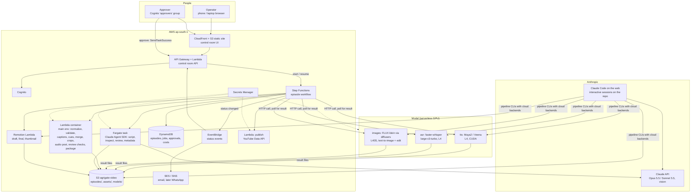
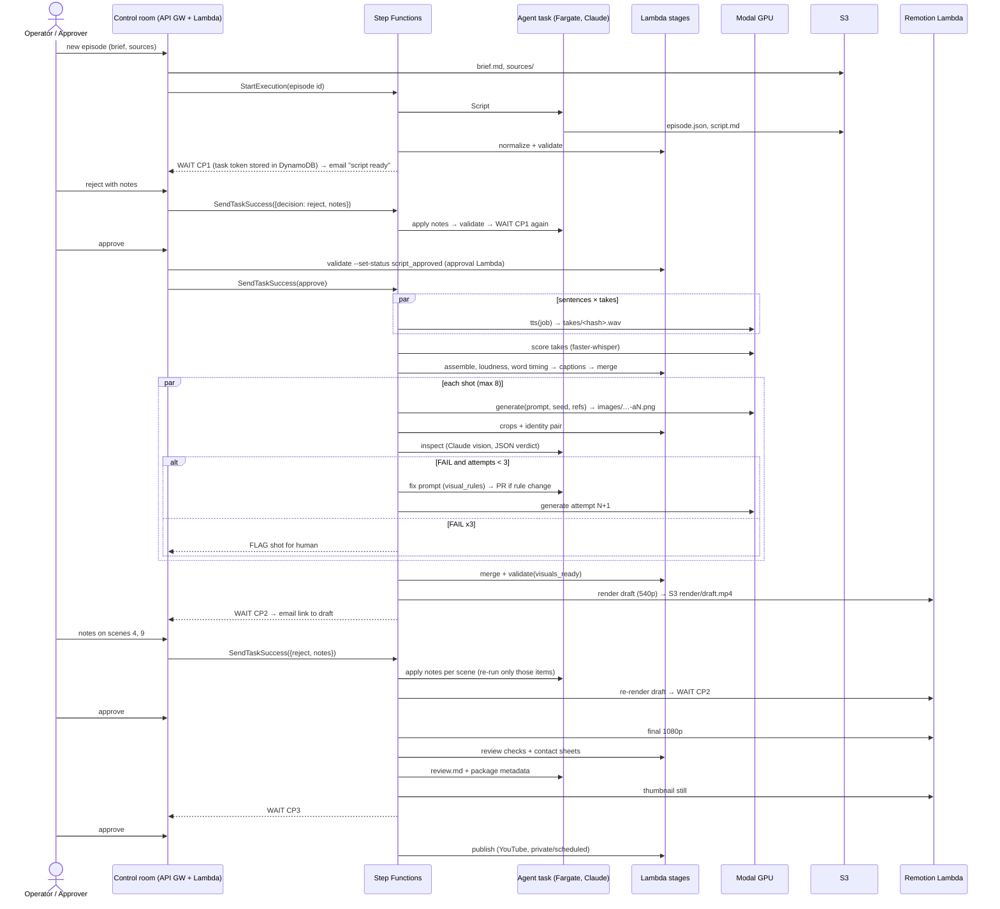

# Cloud architecture proposal (Claude, 2026-11-22)

> **Audience:** the AgriGate team, comparing this against other models' answers to `docs/cloud/prompt-for-other-models.md`. Same headings A–L as that prompt.
> **Basis:** this repo (`docs/ARCHITECTURE.md`, `PROJECT_BRIEF.md`, `config.yaml`, `docs/timings.md`, the bake-off report) plus a light web check of pricing and support claims (section L). Prices are approximate, so check them before committing.

---

## A. Summary recommendation

1. **AWS is the home** (ap-south-1, Mumbai): S3 for every file, Step Functions for the episode workflow, Lambda for the light Python stages, DynamoDB for the episode index and job records, Cognito for the people who approve, CloudFront for previews.
2. **GPU work goes to Modal** (serverless GPUs, billed per second, scale to zero): TTS takes, Whisper scoring and word timing, image generation. This is the only second vendor. At ~12 episodes a month we use maybe 5–10 GPU hours, and Modal turns that into a few dollars with no GPU quotas, AMIs or idle instances to manage. The workers stay plain containers, so **AWS Batch on g6 Spot** remains the way out if we later want everything on AWS.
3. **Rendering moves to Remotion Lambda.** It supports ap-south-1, costs cents per render and reads assets from S3. Licence (corrected 2026-11-22): free if AgriGate as a whole organisation has ≤3 people; otherwise Remotion for Automators, $0.01 per render with a $100/month minimum.
4. **Claude works in two modes on the same stage code.** *Interactive:* Claude Code on the web runs the existing skills against the GitHub repo, and the heavy stages call the cloud. *Unattended:* Claude Agent SDK tasks run inside the Step Functions workflow and pause at the checkpoints.
5. **Checkpoints are enforced by IAM, not by convention.** Only an approval Lambda, called by a person in the Cognito `approvers` group, can advance status to `script_approved`, `final_rendered` or `packaged`. The agent's role is denied.
6. **`episode.json` stays the contract.** Workers never write it directly. They write per-item result files, and one merge step folds them in with an S3 conditional write (`If-Match`).

Build interactive mode first (phases 1–3, section J). It removes the Mac with the least change. Unattended mode comes after.

## B. Architecture diagram



## C. Service per job

| Job | Service | GPU / size | Why | Rejected | ≈ cost / episode |
|---|---|---|---|---|---|
| Brief, sources intake | Control room form → S3 `sources/`. Claude fetches official PDFs (web fetch) | — | Sources must be files, as today | — | ~0 |
| Script (`hindi-script`) | Interactive: Claude Code on the web. Unattended: Agent SDK on **Fargate** (1 vCPU, 2 GB, ~10–30 min) | — | Needs file and tool access, and runs longer than Lambda's 15 min limit when it fetches sources | Lambda (time limit); plain API call (no tools) | Claude tokens (see I) |
| text_normalize, validate, captions, cues, crops, merge | **Lambda** container image (main env, Python 3.12) | 1–2 GB | Pure Python, seconds each | Fargate (slower start) | <$0.01 |
| TTS takes (Maya2, Veena) | **Modal** function, transformers on CUDA (vLLM later if throughput matters) | **L4 24 GB** | Small LMs plus an audio codec (Maya2: Qwen3-1.7B + Mimi; Veena: Llama-style + SNAC), so they fit easily. Fan out sentences × takes across containers | SageMaker real-time (idle cost); AWS Batch (several-minute cold start per job) | ~$0.20–0.50 |
| Take scoring + word timing | **Modal**, faster-whisper large-v3-turbo with word timestamps + librosa pitch | L4 | Same speed class as mlx-whisper; CTranslate2 is mature | WhisperX (word alignment we don't need; we align to the script ourselves) | ~$0.05 |
| Audio post (trim, joins, loudness) | **Lambda** with ffmpeg | 3 GB, 10 GB `/tmp` | ~10 s per episode today | — | <$0.01 |
| Cast references, shot images (text-to-image + edit) | **Modal**, diffusers `Flux2KleinPipeline` / the bake-off winner | **L40S 48 GB** (bf16, no quantization) | 48 GB holds bf16 weights + text encoder + references; shots fan out in parallel | Replicate / fal hosted endpoints (less control over seeds and edit mode; license terms per host) | ~$0.50–1.50 |
| Image inspection (mandatory) | **Claude API, vision**: full image + 4 crops + identity pair, structured verdict incl. `action:` | — | The rule says a strong vision model decides; local VLMs failed the eval (§7.6b) | Open VLM as decider (30% false fails) | Claude tokens (largest line) |
| Optional pre-screen | Modal, open VLM (e.g. Ministral 3 14B in bf16, or larger) | L40S | Advisory only, as today; worth re-running the eval at full precision | — | ~$0.10 |
| Draft / final render, thumbnail | **Remotion Lambda** (ap-south-1), site bundle on S3, assets via presigned URLs | 2–3 GB Lambdas, parallel chunks | A 4-min video in about a minute; pay per render | Remotion on Fargate/ECS (slower, more to run); ffmpeg rewrite (loses the compositions) | ~$0.10–0.40 incl. draft re-renders |
| Review checks (loudness, black/freeze, contact sheets) | **Lambda** with ffmpeg + Pillow (Linux ffmpeg has `drawtext`, but keep Pillow) | 3–4 GB | Under a minute | — | <$0.02 |
| Review + package judgement | Claude API (contact sheets, metadata) | — | Same as today | — | tokens |
| Publish (planned) | **Lambda**: YouTube Data API v3, OAuth refresh token in Secrets Manager, upload private/scheduled | — | Only runs after checkpoint 3 | — | ~0 |
| Control room | **S3 + CloudFront** static UI, **API Gateway + Lambda** API, **Cognito** login, live status by polling DynamoDB | — | Scales to zero, phone-friendly, signed URLs for audio and video playback | App Runner / always-on Fargate service (fixed cost) | ~$1–3 / month |
| Notifications | EventBridge → SES email (WhatsApp Business later) | — | "Draft ready to review" with a link | — | ~0 |

## D. Orchestration, Claude's role and human checkpoints

**Workflow engine: AWS Step Functions (Standard), one execution per episode.** It is serverless and pay-per-transition. Its Map state fans out over shots and over sentences × takes with a concurrency cap, and its `.waitForTaskToken` callback pauses for a human for days. Temporal would also work, but it means running a server or paying for Temporal Cloud, which is too much for a 1–2 person team. LangGraph fits the agent's inner loop better than the outer pipeline, and the Agent SDK already covers that loop.

The workflow mirrors the status machine:

```
CreateEpisode → Script(agent) → Normalize → Validate(as draft)
  → WAIT CP1 (task token)  ──reject+notes──► Script(agent, apply notes) ↺
  → SetStatus(script_approved, approval Lambda)
  → Narration: Map(sentences × takes) on Modal → Score(Modal) → Assemble+Loudness(Lambda) → WordTiming(Modal) → Captions(Lambda)
  → Visuals: Map(shots, max 8 at a time):
        Generate(Modal) → Crops(Lambda) → Inspect(Claude API)
        └ fail & attempts<3 → FixPrompt(agent, visual_rules) → Generate ↺
        └ fail ×3 → FLAG shot → human decides in the control room
     → Graphics+Cues(Lambda) → Merge → Validate(visuals_ready)
  → DraftRender(Remotion Lambda) → WAIT CP2 ──notes──► ApplyNotes(agent, per scene) → DraftRender ↺
  → FinalRender → Review(Lambda checks + Claude) → Package(Claude + Remotion still)
  → WAIT CP3 → Publish(private/scheduled)
```

**Claude has two ways in, both using the same stage code:**
- *Interactive (build first).* Claude Code on the web opens the GitHub repo in Anthropic's cloud sandbox and follows the same skills. Stages read and write the episode through a storage layer (S3), and backends `modal_tts`, `modal_images`, `modal_asr` and `remotion_lambda` are chosen in `config.yaml`. Claude still downloads PNGs and crops and looks at them itself. The sandbox needs network access to S3, Modal and Hugging Face, plus scoped credentials (an IAM user limited to the bucket, and a Modal token) set in the environment settings. This mode needs no laptop: it works from a browser or phone.
- *Unattended.* Each judgement step is a Fargate task running the **Claude Agent SDK**. It loads the relevant skill text as instructions and gets a small set of tools: read/write episode files, run a stage CLI, fetch a URL, record an inspection. Each task has a cap on steps and tokens. Image inspection can be a plain Claude API call with a JSON schema (verdict, notes, `action:`, identity) and doesn't need the full agent. When an inspection fails, the agent may propose a `visual_rules.yaml` change. It opens a **GitHub PR** for you to merge rather than editing the library silently.

**Checkpoints enforced by permissions:**
- The agent's IAM role and the Modal workers' credentials **cannot** call `SendTaskSuccess` on checkpoint tokens. They also cannot invoke `validate --set-status` for the three human statuses.
- Only the approval Lambda can do either, and it only acts for a Cognito user in `approvers`. It runs `validate --set-status`, appends `CHECKPOINT n APPROVED by <user> at <time>` to `log.md` and stores the decision in DynamoDB.
- In interactive mode the same rule holds: status changes for the human checkpoints go through the control room, and the sandbox credentials lack that permission. This replaces today's reliance on the auto-mode classifier.
- Rejections carry notes. The workflow loops back to the agent with them, scene by scene, as today.

## E. Data and storage

**S3 bucket `agrigate-video-<env>`** (versioning on; SSE-S3; public access blocked; CloudFront with signed URLs for previews):

```
episodes/<id>/episode.json             ← the contract, versioned
episodes/<id>/{brief.md, script.md, youtube.md, log.md}
episodes/<id>/sources/…
episodes/<id>/audio/takes/<hash>.wav|json   (lifecycle: Glacier IR after 60 days)
episodes/<id>/audio/scene-XX.wav, words/, segments/
episodes/<id>/images/scene-XX-sK-aN.png, inspect/   (inspect/ expires after 30 days)
episodes/<id>/render/{draft.mp4, video.mp4, thumbnail.png, props.json}
episodes/<id>/review/…
episodes/<id>/results/<stage>/<item>.json   ← per-item worker outputs, merged into episode.json
assets/{cast, brand, broll, music}/, config/{visual_rules.yaml, pronunciation.yaml}  (synced from git on deploy)
models/  (only if not using Modal Volumes for weights)
```

**One small code change makes this work everywhere.** `pipeline/common.py` gets a storage layer (`fsspec`: local disk or `s3://`). Episode paths inside `episode.json` stay relative, so the same code runs on the Mac, in the Claude Code sandbox, in Lambda and on Modal.

**Keeping `episode.json` atomic with parallel workers.** Workers never write `episode.json`. Each writes `results/<stage>/<item>.json`, for example `results/images/scene-07-s1-a2.json` with seed, file and SHA-1. A **merge step** (Lambda, the only writer) reads `episode.json` with its ETag, applies the results through the pydantic model (`save_episode` still validates), and writes with `If-Match: <etag>`. On a 412 it re-reads and retries. A bucket policy can require the conditional header on that prefix. This is the cloud version of today's temp-file-then-`os.replace`. S3 versioning gives the full history git gives today for the text files. Optionally, a nightly job commits the text files to the repo for diff-friendly review.

**DynamoDB** (on demand) holds what the control room queries: episodes (id, status, format, updated), jobs (stage, item, start, end, cost, executor), approvals, and a usage/cost ledger. It is an index, not the source of truth: it can always be rebuilt from S3.

**`log.md`** stays: the merge Lambda appends stage records to it in S3 (conditional write), and CloudWatch keeps the raw logs.

**Model weights** live in Modal Volumes or are baked into the container images, downloaded once from Hugging Face with the token from Secrets Manager. Indic Parler is gated, so accept its terms on the org account.

## F. Messaging and event flow (one episode)



Stages talk through **S3 and the workflow's state**: each step gets the episode id plus item keys and returns small JSON. Large data never travels in messages, because the Step Functions payload limit is 256 KB. EventBridge carries "status changed / job finished / checkpoint waiting" events to notifications and the control room. No queue is needed while Step Functions drives Modal directly. Add SQS only if you add AWS Batch.

## G. Porting the Mac-only parts

| Component | Today (MLX) | Cloud runtime | Risk | Parity test |
|---|---|---|---|---|
| Maya2 Native (Vasant) | mlx-audio | Maya Research's PyTorch inference (Qwen3-1.7B LM + Kyutai Mimi decoder) on CUDA in bf16; vLLM later for batched takes. Check that the reference code runs outside mlx-audio | Different precision and sampling may change prosody and pace (wpm feeds the length targets). Mimi's edge bursts (§7.4) may differ, so re-check join trimming | Same 4 pilot scenes × 5 takes: mean take error ≤ 0.021 (Mac figure), wpm within ±5%, blind listening by the user |
| Veena (varun) | `snac_lm_worker.py` on mlx-lm | Same worker on `transformers`; SNAC is already PyTorch | Voice drift (~1 take in 5 on the Mac) may differ | Identity-score drift rate, take error ≤ 0.068, listen |
| Whisper large-v3-turbo | mlx-whisper | faster-whisper (CTranslate2, fp16) | Word timestamps differ slightly; `initial_prompt` behaviour differs | Re-run the §7.4a measurement on v3: 637/637 words matched, ≥ 61/70 pauses within one frame |
| Images | mflux (klein 4B q4; bake-off leader FLUX.3 Klein q8) | diffusers on L40S in bf16 | Seeds don't reproduce across runtimes. Multi-reference edit in open weights needs checking in the diffusers source. bf16 should look *better* than q4 | Re-run the 12-shot bake-off spec at seeds 11/22/33 with blind user rating; must match or beat the Mac pass rate |
| Local VLM pre-screen | mlx-vlm | vLLM / transformers on L40S | none (advisory) | `vlm_inspect --eval` on the 77 labelled shots |
| Remotion | local Chrome, VideoToolbox | Remotion Lambda, x264 | Asset URLs replace hard-linked `public/`; fonts must be in the deployed site bundle | `test_phase5` timing parity + FontTest still from Lambda |
| Dashboard usage meter | `ps` / `ioreg` sampler | Job records: duration × rate per executor; Claude usage from API responses | Electricity metric disappears (replaced by $) | Cost per episode visible per stage |
| Tests | local pytest | GitHub Actions on every push | — | 101 tests green in CI |

Once the 16 GB limit is gone, the bake-off can add bf16 variants and larger commercially licensed models, for example Qwen-Image-2512 (Apache-2.0), which was infeasible locally (28 GB peak). The license rules don't change. Note that the cloud sandbox is Linux, so the `mflux` / `mlx_*` backends stay as Mac-only options in config.

## H. Security, licenses and operations

- **Code on GitHub first.** The repo has no remote today, and Claude Code on the web, CI and deploys all need one. Use a private repo; keep media out of git as now.
- **Secrets Manager:** Anthropic API key, Hugging Face token, Modal token, YouTube OAuth client and refresh token. Modal reads its copies from Modal Secrets.
- **IAM roles:** separate roles for agent, workers, merge, approval and publish. Only `merge` writes `episode.json`; only `approval` sets the human statuses and sends checkpoint tokens; only `publish` reads the YouTube secret.
- **IaC:** AWS CDK (Python, to match the team's language). Modal apps deploy with `modal deploy` from GitHub Actions; AWS access via GitHub OIDC (no long-lived keys).
- **Logging and cost:** CloudWatch logs with 30-day retention; every job writes a cost record (GPU seconds × rate, Lambda GB-s, Claude tokens × price) tagged by episode and stage, which replaces the local usage page. Add AWS Budgets alerts plus a Modal spending limit.
- **Licenses (unchanged rules):** keep the Mimi codec's CC-BY-4.0 attribution (already in `docs/licenses.md`) in the YouTube description template; add Modal, faster-whisper (MIT), CTranslate2 (MIT), diffusers (Apache-2.0) and any new model to `docs/licenses.md`. **Remotion:** free for organisations of ≤3 people (automation included); above that, Automators at $0.01 per render with a $100/month minimum. Lambda renders count. Don't let hosted image APIs replace self-hosting without checking each model's license on that host.
- **Data:** nothing personal beyond approvers' emails; ap-south-1 keeps data in India.

## I. Cost model (rough; check prices before committing)

| | 12 episodes / month | 60 episodes / month |
|---|---|---|
| Modal GPU (TTS + Whisper + images, incl. retries and cold starts) | ~$10–25 | ~$50–120 |
| Remotion Lambda (drafts ×3 + final + thumbnail) | ~$2–5 | ~$10–25 |
| Lambda, Step Functions, DynamoDB, EventBridge, SES | ~$2–5 | ~$5–15 |
| S3 (~50–300 GB with lifecycle) + CloudFront | ~$3–8 | ~$10–25 |
| Fargate agent tasks | ~$1–3 | ~$5–15 |
| Secrets, CloudWatch, Cognito | ~$5–10 | ~$10–20 |
| **Claude API (script, inspection of ~50 image attempts with crops (v3: 49), review, metadata)** | **~$100–250** | **~$500–1,200** |
| Remotion company license | check remotion.pro | check remotion.pro |

- **Claude dominates.** Use the dashboard's measured Claude $/episode as the real baseline, not these guesses. Image inspection is most of it.
- **Biggest savings:** fewer failed images (the scene-spec + bake-off work), prompt caching of the checklist and rules, and Sonnet for routine steps (metadata, contact sheets) with Opus kept for script and inspection.
- Interactive sessions on a Claude subscription aren't billed per token, so phase 3 costs less than unattended mode.
- **Rejected:** an **EC2 Mac** to run everything unchanged. It is a dedicated host with a 24-hour minimum, about $500+/month if left allocated, with no parallelism and still one machine. An always-on GPU VM (g6.xlarge on-demand) runs ~$600/month for under 10 busy hours. Kubernetes is too much to operate for this team.

## J. Phased migration plan

Each phase is usable on its own; the Mac keeps working until phase 3.

| Phase | Work | Still on the Mac | Acceptance test |
|---|---|---|---|
| **0. Foundations** (1–2 days) | Private GitHub repo + CI (pytest, `tsc`); CDK stack: S3 bucket, Secrets, IAM; storage layer in `common.py` (local or S3); one-time sync of `episodes/` and `assets/` to S3 | everything | Tests green in CI; an episode round-trips Mac → S3 → Mac byte-identical |
| **1. GPU on Modal** (3–5 days) | `modal_tts`, `modal_asr`, `modal_images` backends behind the existing JSON worker contracts; weights in Modal Volumes | Claude Code + light stages + Remotion | The parity tests in G pass on the pilot scenes and the 12 bake-off shots; you approve by ear and blind rating |
| **2. Render in the cloud** (2–3 days) | Deploy the Remotion site to S3, `remotion_lambda` render backend, review checks in Lambda | Claude Code + light stages | v3 re-rendered on Lambda matches the Mac render: duration within 0.15 s, FontTest OK, review checks pass |
| **3. Mac-free interactive** (2–3 days) | Claude Code on the web environment (network allowlist, scoped credentials); minimal hosted control room (episode list, play audio/video, approve with notes) with Cognito; approval Lambda + IAM denial for the agent | nothing | A Short produced end to end from a phone browser; an approval attempt from the agent's credentials is refused |
| **4. Unattended workflow** (1–2 weeks) | Step Functions state machine; Agent SDK tasks; Claude API inspection with JSON verdicts; result files + merge; notifications | — | One long episode run unattended between checkpoints; inspection verdicts agree with Claude Code's interactive verdicts on the 77 labelled shots |
| **5. v1 features** | YouTube publish, analytics → topics, music ducking, Shorts re-cut, image-to-video on Modal | — | per feature |

## K. Risks and open questions

**Risks**
- **TTS parity.** Maya2/Veena voices may sound slightly different on CUDA. If you prefer the MLX sound, a fallback is to keep TTS on an EC2 Mac only for narration, which is costly. Test this first (phase 1).
- **Edit mode in diffusers.** Multi-reference editing for klein in open weights needs checking. Fallback: ComfyUI on Modal, which has broader FLUX.2 support.
- **Claude Code on the web sandbox limits** (network allowlist, session length, downloading large files) may slow interactive inspection. Fallback: a small EC2 dev box running Claude Code over SSH.
- **Vendor split** (AWS + Modal): two bills and two sets of credentials. Exit path: AWS Batch on g6 Spot with the same containers.
- **Claude cost growth** at 60 episodes/month. Track inspection tokens per image from day one.

**Open questions for you**
1. Is a second vendor (Modal) acceptable, or must everything be on AWS?
2. Monthly budget ceiling, and should unattended runs exist at all, or is interactive-in-the-cloud enough?
3. Who approves? One person, or several with roles (script approver ≠ video approver)?
4. Should Claude usage be on the API (per token) or kept within Claude Code subscriptions where possible?
5. When do you buy the Remotion company license: before phase 2 (Lambda renders) or before the first public upload?
6. Is ap-south-1 required (data in India), or is any region fine?

## L. Sources consulted

Checked 2026-11-22 with a light web search, not deep research. Confidence is medium on prices and high on the architecture patterns.

- Modal pricing: [modal.com/pricing](https://modal.com/pricing): L4 ~$0.80/h, L40S ~$1.95/h, A100 80 GB ~$2.50/h, per-second billing (rates as quoted by several 2026 summaries, e.g. [computeprices.com](https://computeprices.com/blog/modal-gpu-pricing-per-second-billing-explained)).
- Remotion Lambda regions (ap-south-1 listed) and costs: [remotion.dev/docs/lambda/region-selection](https://www.remotion.dev/docs/lambda/region-selection), [cost example](https://remotion.dev/docs/lambda/cost-example), license with cloud-rendering units: [remotion.dev/docs/lambda/faq](https://remotion.dev/docs/lambda/faq).
- diffusers FLUX.2 / `Flux2KleinPipeline` and klein 4B reference editing (Apache-2.0): [diffusers Flux2 docs](https://huggingface.co/docs/diffusers/en/api/pipelines/flux2), [FLUX.2-klein-4B model card](https://huggingface.co/black-forest-labs/FLUX.2-klein-4B). Multi-reference support in open weights is reported inconsistently, so it needs a test.
- Step Functions callback pattern and heartbeats: [Step Functions best practices](https://docs.aws.amazon.com/step-functions/latest/dg/sfn-best-practices.html), [service integration patterns](https://docs.aws.amazon.com/en_us/step-functions/latest/dg/connect-to-resource.html).
- S3 conditional writes (`If-Match` compare-and-swap, enforceable by policy): [AWS Storage Blog](https://aws.amazon.com/blogs/storage/building-multi-writer-applications-on-amazon-s3-using-native-controls).
- Project facts: `docs/ARCHITECTURE.md`, `docs/timings.md`, `bakeoff/report.md`, `config.yaml`.
