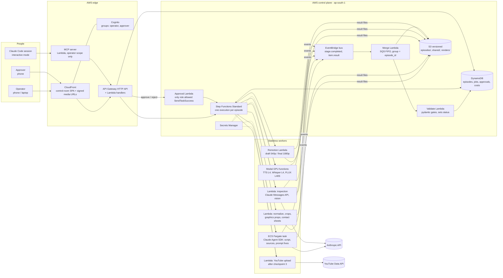
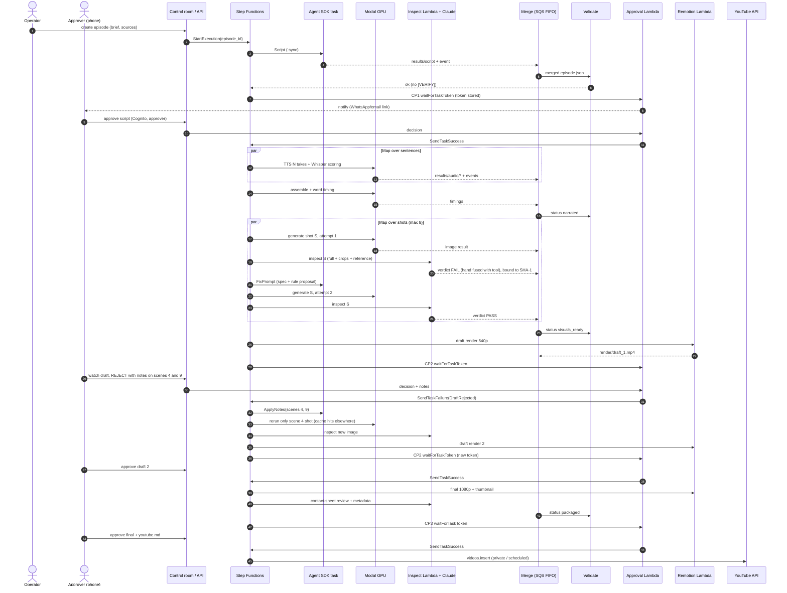

# AgriGate Hindi video pipeline — cloud architecture

Nov 22, 2026 · @Gopal sharma

> **Evidence caveat.** This session had no web access (the sandbox allowlist blocks AWS, Modal, Remotion, Hugging Face and Anthropic docs), so nothing below was re-checked live in Nov 2026. Service behaviour and prices come from knowledge current to mid-2026 and are marked **approximate**. Every price and limit carries a "verify" pointer in section L. Treat the architecture as the deliverable and the numbers as a first-pass budget to confirm in Phase 0.

## A. Summary recommendation

Run the control plane on AWS (ap-south-1, CDK) and rent GPUs per second from one serverless GPU vendor; nothing is always on.

1. **Orchestration:** AWS Step Functions (Standard) per episode, with `waitForTaskToken` for the three checkpoints and Map states for shots × attempts and sentences × takes.
2. **GPU work** (TTS, Whisper, FLUX): **Modal** (per-second billing, scale to zero, seconds-level cold start) on L4 / L40S. AWS Batch on g6/g6e is the built and tested fallback using the same container image.
3. **Claude:** plain Messages API calls (structured JSON output) for image inspection, contact-sheet review and metadata; **Claude Agent SDK in an ECS Fargate task** for script research/writing and prompt fixing; an MCP server over the control-plane API for interactive sessions from Claude Code anywhere.
4. **Render:** Remotion Lambda for draft and final; paid Remotion company licence budgeted.
5. **State:** S3 (versioned) for artefacts, DynamoDB for status, jobs, approvals and costs. Workers never write `episode.json`; a single serialised merge function does, with S3 conditional writes.
6. **Checkpoints:** only a Cognito user in the `approver` group can release a task token; every machine role carries an explicit IAM deny on `states:SendTaskSuccess`.
7. **Cost:** roughly $250–330/month at 12 episodes and $700–1,100 at 60 (approximate). Claude tokens dominate; GPU is under $1 per episode.

## B. Architecture diagram

Three trust zones: humans (Cognito), the AWS control plane, and stateless compute that can only write result files and emit events.



The GPU box is the only component outside AWS. Modal assumes an AWS IAM role through OIDC to read inputs from and write results to a prefix-scoped part of the S3 bucket.

## C. Service per job

Every stage keeps its current function contract; only the runner changes. Costs are approximate per 4-minute long episode, including typical retries (section I shows the assumptions).

| Job | Service | GPU / size | Why | Rejected alternatives | Est. cost / episode |
| --- | --- | --- | --- | --- | --- |
| 0 New episode | API Lambda writes `brief.md` + empty `episode.json` to S3, row in DynamoDB | 512 MB | Seconds of work | — | \~$0 |
| 1 Script + source fetch | ECS Fargate task running the Claude Agent SDK with the existing skills; web fetch allowlisted to gov.in, icar.org.in, state agri-university domains | 1 vCPU / 4 GB, ARM | Agent loop needs files, web and many turns; runs can exceed Lambda's 15 min | Lambda (time cap); one-shot API call (loses the research loop) | Claude $1.5–3; Fargate <$0.05 |
| 1a Normalize, 1b Validate | Lambda (Python container image shared with merge/validate) | 1 GB | Pure Python, must be the single gatekeeper | — | \~$0 |
| 2 TTS takes (N per sentence) | Modal function, vLLM or transformers | 1× L4 24 GB | 3B Llama-style LM in bf16 fits with batching headroom; all sentences × 6 takes in one batched run | AWS Batch g6.xlarge (fallback; 3–6 min cold start, G-instance quota); SageMaker async; Polly / ElevenLabs (loses existing voices) | $0.15–0.40 |
| 2 Take scoring | Modal, faster-whisper large-v3-turbo + existing pitch/gap/identity code | L4 (same app as TTS, chained) | CTranslate2 GPU is fast; avoids a second cold start | CPU Whisper (minutes per take) | $0.05–0.10 |
| 2a Word timing | Modal, faster-whisper `word_timestamps=True`, then the existing alignment/snap code on Lambda | L4 | Same model family as mlx-whisper, smallest behaviour change | WhisperX (wav2vec2 Hindi aligner licences vary; test later) | \~$0.02 |
| 3 Cast reference | Modal, same image app as 3a | L40S 48 GB | One-off, human-approved | — | one-off |
| 3a Images (shots × attempts) | Modal function per shot, diffusers or ComfyUI headless | L40S 48 GB (L4 suffices for klein 4B) | bf16, unquantised; room to test larger licensed models | Always-on GPU VM; image APIs as primary (seed/edit control) | $0.30–0.80 |
| 3b Image inspection | Lambda: Pillow builds full image + 2× crops + side-by-side, then one Claude Messages API call with a JSON verdict schema | 2 GB | Strong VLM decides; deterministic, cheap, parallel (Map, max concurrency \~8) | Open VLM as judge (already rejected); Agent SDK per image (overkill) | Claude $2–6 |
| 3c Graphics props | Lambda + one Claude call | 1 GB | Small structured output | — | \~$0.10 |
| 4 Draft render (540p) | Remotion Lambda `renderMediaOnLambda` | 2–3 GB functions | Fast (\~1 min) for repeated draft loops, scales to zero | Remotion on Fargate (fallback, slower but simpler) | $0.05–0.15 per render, ×3–4 |
| 5 Final render (1080p) | Remotion Lambda | 3 GB functions | Same bundle as draft, deterministic | MediaConvert (cannot run React compositions) | $0.10–0.30 |
| 6 Review | Lambda container with ffmpeg + Pillow (sheets, loudness, black/freeze) + Claude vision on sheets | 3 GB | Same checks as today | — | Claude $0.30–0.80 |
| 7 Package | `renderStillOnLambda` thumbnail + Claude for metadata | — | Same Remotion bundle | — | $0.10–0.20 |
| Upload (after CP3) | Lambda + YouTube Data API `videos.insert`, private or scheduled | 1 GB | Only after approval; resumable upload from S3 | Manual upload (keep as fallback) | \~$0 |
| Remotion licence | Per-render fee under the company licence | — | Required for commercial use | — | \~$0.05 |

**Cold starts and quotas at our volume:** Modal containers start in seconds to tens of seconds once weights sit on a Modal Volume (not downloaded per call). AWS Batch GPU fallback adds 3–6 minutes per batch for instance launch and image pull. New AWS accounts often have a G/VT on-demand vCPU quota of 0, so request quota in Phase 0 even for the fallback. Remotion Lambda needs Lambda concurrency well above 10; new accounts are sometimes capped at 10, so check and raise it.

## D. Orchestration, Claude's role and human checkpoints

**Step Functions Standard runs each episode as one execution; Claude does judgement inside steps; humans release checkpoints through a role the automation does not have.**

### Why Step Functions

- Standard workflows run up to one year, so a checkpoint can wait days at no compute cost. Billing is per state transition (about $0.025 per 1,000, approximate), which is cents per episode.
- `.waitForTaskToken` is the native human-wait primitive. Retries, backoff and catch are declarative per state. Map / Distributed Map gives fan-out with a concurrency cap.
- The team already deploys Lambdas with CDK, so there is no new platform to run.
- **Rejected:** Temporal (excellent, but another system to host or pay for; worth revisiting only if workflows become code-heavy); LangGraph as the orchestrator (fine for agent reasoning, weak for durable infra fan-out and IAM-enforced approvals); Prefect/Dagster (data-pipeline oriented, need a worker fleet); Inngest (good DX, but a second vendor in the critical path for little gain over Step Functions).

### Workflow shape

1. `Script` (Agent SDK task, `.sync`) → `Validate(script)` → **CP1 wait**.
2. `Narration`: Map over sentences, each item calls one Modal batch for N takes, then scoring; merge; `PickTakes` (Lambda) → `Assemble` (loudness −14 LUFS) → `WordTiming` → `Validate(narrated)`.
3. `Visuals`: Map over shots (max concurrency 8). Inside each item: `Generate` → `Inspect` → Choice: pass → done; fail and attempt < 3 → `FixPrompt` (Claude, updates spec and proposes a `visual_rules.yaml` change) → `Generate`; three fails → `NeedsHuman` (a task-token wait for that shot only, the others continue). → `Validate(visuals_ready)`.
4. `Graphics` → `DraftRender` → **CP2 wait**. Rejected with notes → `ApplyNotes` (Agent SDK, scene-scoped) → re-enter only the affected stages via `--scene N` → `DraftRender` → CP2 again (loop).
5. `FinalRender` → `Review` → `Package` → **CP3 wait** → `Upload` (private / scheduled).

Per-scene reruns are an API call that starts a *child* execution for one stage with `scene=N, force=true`. Existing caches (content-hashed takes and images) make reruns skip finished work, exactly as today.

### Claude's role

| Judgement step | How it runs | Model tier |
| --- | --- | --- |
| Script + source fetching, `[VERIFY]` marking | Agent SDK in Fargate, skills mounted from the repo image, workspace synced from `s3://…/episodes/{id}/` | Strongest available |
| Image inspection | Messages API, structured JSON verdict, cached system prompt + `visual_rules.yaml` | Strongest available (vision) |
| Prompt fixing after a failed inspection | Messages API (small) or Agent SDK if it must edit rules | Strong |
| Draft-note application | Agent SDK, scene-scoped | Strong |
| Contact-sheet review, metadata | Messages API | Mid tier is likely enough; A/B it |

**Interactive mode.** The operator keeps chatting with Claude Code (on the Mac, any laptop, or Claude Code on the web). Instead of running stages locally, the session uses an **AgriGate MCP server** exposing `get_episode`, `list_jobs`, `run_stage(scene?, force?)`, `get_media_url`, `record_inspection`, `request_checkpoint`. It authenticates with a Cognito machine client in the `operator` scope. There is **no** approve tool, and the API rejects approvals from that client. Images are fetched through short-lived signed URLs so Claude can still look at every PNG.

**Unattended mode.** A backlog item (crop-calendar driven, later) starts an execution; the same Agent SDK and API steps run and the execution parks at each checkpoint. Interactive and unattended share one workflow definition: interactive just means a human is also driving `run_stage` calls between checkpoints.

### Checkpoints that automation cannot pass

- The task token is written to an `approvals` DynamoDB item that only the Approval Lambda role can read.
- A **permission boundary on every machine role** (Fargate agent, workers, Modal's assumed role, merge, MCP) contains an explicit `Deny states:SendTaskSuccess, states:SendTaskFailure` and a deny on writes to the approvals table. An explicit deny beats any allow, so a mis-scoped policy cannot grant it.
- The approve endpoint requires a Cognito ID token from a human user in the `approver` group (TOTP MFA on). Machine clients cannot be in that group.
- An approval records `{checkpoint, episode_id, approver sub + email, time, episode.json S3 VersionId, SHA-256 of the reviewed draft/final MP4, notes}`. If `episode.json` changes after approval, `Validate` sees a mismatched version and refuses to advance.
- The Anthropic API key carries no AWS credentials, so Claude itself has no path to the approval call.
- For a 1–2 person team the operator and approver may be the same human; that is allowed because the separation that matters is human vs agent.

### Control room and approvals on a phone

- **Hosting:** the existing control-room features rebuilt as a small React SPA on S3 + CloudFront, backed by API Gateway HTTP API + Lambda reading DynamoDB. Cognito Hosted UI login with TOTP MFA; groups `operator` (start/stop/retry stages, edit briefs, accept rule diffs) and `approver` (checkpoint decisions, verdict overrides).
- **Live progress:** the SPA polls the `jobs` table every 3–5 s (enough at this scale); upgrade to API Gateway WebSockets only if polling becomes a problem.
- **Review pages, mobile first:** CP1 shows the script with sources per scene and plays per-scene audio once narrated; CP2 plays the 540p draft from a signed CloudFront URL, and tapping "note" captures the playback time, which maps to a scene through word timings; CP3 shows the final, thumbnail, `youtube.md` and the review report. Each page has Approve / Reject with notes.
- **Notifications:** SNS to email for everything; Slack incoming webhook for the team; WhatsApp through AWS End User Messaging Social for "waiting for your approval" messages with a deep link (requires a WhatsApp Business account and approved message templates).
- **Blind image-rating page** for bake-offs moves over unchanged, writing ratings to DynamoDB.

## E. Data and storage

**`episode.json` stays the contract, lives in versioned S3, and has exactly one writer: a merge function serialised per episode.**

### S3 layout (one bucket, versioning on, SSE-KMS, Block Public Access)

```
s3://agrigate-video-prod/
  episodes/{episode_id}/
    brief.md  script.md  youtube.md  log.md (append via merge only)
    episode.json                         <- versioned; single writer
    sources/  (PDFs + README.md of URLs and conflicts)
    results/{stage}/{item_key}/{attempt}-{content_hash}.json   <- immutable worker outputs
    audio/takes/{sentence_id}/{take_hash}.wav + .metrics.json
    audio/final/scene_{n}.wav  audio/word_timings.json
    images/{scene}/{shot}/attempt_{k}_{sha1}.png
    images/{scene}/{shot}/inspection/{sha1}/crop_*.png, sidebyside.png, verdict.json
    render/draft_{n}.mp4  render/video.mp4  render/thumbnail.png
    review/contact_*.jpg  review/review.md
  shared/cast/  shared/brand/  shared/fonts/
  shared/rules/visual_rules.yaml  shared/rules/pronunciation.yaml  shared/config/
  remotion/  (Remotion Lambda site bundles, per version)
```

Files keep today's names, so `sync pull` reproduces the current local folder exactly. Content hashes in keys make every attempt immutable and give caching for free.

### DynamoDB (on-demand)

| Table | Key | Holds |
| --- | --- | --- |
| `episodes` | `episode_id` | status, format, current `episode.json` VersionId + ETag, execution ARN, cost totals |
| `jobs` | `episode_id`, `job_id` | stage, scene, item, state, progress %, ETA, attempts, worker log URL |
| `approvals` | `episode_id`, `checkpoint#n` | task token (Approval role only), decision, who, when, reviewed hashes, notes |
| `costs` | `episode_id`, `stage#ts` | Claude tokens (from API `usage`), GPU seconds × rate, Lambda/Fargate seconds |

### Concurrency for `episode.json`

1. Workers (40 shots × attempts, sentences × takes) **never** touch `episode.json`. Each writes an immutable result file under `results/` and publishes `item.result` to EventBridge.
2. EventBridge routes results to an **SQS FIFO queue with `MessageGroupId = episode_id`**. That gives one in-flight merge per episode while different episodes merge in parallel. Deduplication uses the result's content hash.
3. The **merge Lambda** reads `episode.json`, applies the result through the same pydantic models (`extra="forbid"`), re-validates, and writes back with an **S3 conditional `PUT` (`If-Match: <ETag>`)**. S3 has supported conditional writes since late 2024. On a 412 it re-reads and retries: belt and braces if anything else ever writes.
4. Merges are idempotent: applying the same result twice is a no-op because records are keyed by item and attempt hash.
5. Only `Validate` changes `status`, as today. Step Functions continues only after the merge for the last item lands, by checking the episode's `jobs` counters rather than racing on events.

Rejected: putting `episode.json` in DynamoDB (400 KB item limit is tight for 25 scenes with per-word timings, and the file contract would split); per-field locking; a relational database (not needed for one aggregate per episode).

### Versioning and retention

- `episode.json` noncurrent versions: kept forever (small; this is the audit trail alongside `log.md` and `approvals`).
- Takes and image attempts not picked: S3 Standard → Standard-IA at 30 days → Glacier Instant Retrieval at 90 days. They stay retrievable for audit.
- Draft renders: delete noncurrent and superseded drafts after 90 days once the episode is `packaged` (the approval record keeps their SHA-256).
- Final `video.mp4`: Standard-IA after 60 days; keep indefinitely.
- Previews: CloudFront with Origin Access Control in front of the bucket; the control room gets **signed URLs** (or signed cookies) valid for minutes. MP4s play progressively on phones; no HLS needed at 540p/1080p.
- At 60 episodes/month storage grows roughly 40–50 GB/month, a few dollars per year of retained data.

## F. Messaging and event flow

**Step Functions invokes work directly (synchronous `.sync` or callback); workers report results through EventBridge → SQS FIFO → merge; humans resume the workflow only through the Approval Lambda.** Webhooks are used for exactly two things: Modal job completion (via its client returning, not inbound) and notifications out.



Notes on the failure paths:

- **Inspection fail:** the failing attempt, its crops, verdict and the prompt diff are all kept; `visual_rules.yaml` changes are proposed as a PR-style diff that the operator accepts in the control room (shared rules are not edited silently mid-episode). After three failed attempts the shot parks in `NeedsHuman` with its own token; a human can override a verdict, which is recorded with identity.
- **Draft rejection** uses `SendTaskFailure` with a named error, caught by a `Catch` that loops back. Each CP2 round gets a new token and a new approval record, so the audit shows every round.
- **Transient errors** (Modal 5xx, Anthropic 429/529, Lambda throttles) use `Retry` with exponential backoff and jitter per state; content failures never retry blindly.

## G. Porting the Mac-only parts

**Expect parity in quality but not bit-identical outputs: seeds, sampling kernels and quantisation differ between MLX and CUDA, so every model is re-baselined with blind A/B, not compared hash for hash.**

| Model | Cloud runtime | What changes / risks | Parity test |
| --- | --- | --- | --- |
| **Maya2 Native** and **Veena** (Llama-style LM + SNAC) | Start with Hugging Face `transformers` (bf16, `generate` with `num_return_sequences=6`) for a faithful port; move to **vLLM** (Llama architecture supported; SNAC decode as a post-step) once parity holds, for batched throughput. SNAC decoder via the `snac` package on the same GPU. | MLX 4/8-bit vs CUDA bf16 changes prosody slightly; seeds do not carry over, so the take-selection loop does the real work. Check special/audio token handling and stop conditions, which are model-card specific. **Confirm both licences** (Apache-2.0 expected for Veena; verify Maya2's card) and whether weights are gated. | 100 sentences across both voices, 6 takes each, both backends. Compare best-take CER, pitch range, gap histogram, speaker-embedding similarity to the approved voice reference. Then blind preference by 2 Hindi listeners on 40 pairs: cloud must not lose by more than 5 points. |
| **Whisper large-v3-turbo** (scoring and word timing) | **faster-whisper** (CTranslate2, MIT), `compute_type=float16`, `word_timestamps=True`, language forced to `hi` | Same model weights; word boundaries come from a different DTW implementation, so expect tens of ms of drift. VAD settings differ from mlx-whisper defaults: pin them. | On 5 finished episodes: median absolute word-boundary difference under 40 ms, 95th percentile under 120 ms; CER within ±0.5 points; caption highlight looks right on a rendered draft. |
| **FLUX.2 \[klein\] 4B** (generate + reference edit) | **diffusers** pipeline for FLUX.2 (multi-reference image input) or **ComfyUI headless** with the official workflow; bf16 on L40S. Weights pre-loaded onto a Modal Volume. | No more 4-bit quantisation, so quality likely rises, but the bake-off winners at 4-bit may not stay winners. Edit-mode reference conditioning API differs between mflux and diffusers; check reference strength defaults. | Re-run the 36-shot bake-off set with the same specs through the cloud runtime, inspected blind by the same Claude rubric plus human ratings: pass rate ≥ the Mac q8 leader (33/36). Identity check: side-by-side vs cast reference on all cast shots. |
| **FLUX.3 Image Klein** (current bake-off leader) | I could not verify diffusers/ComfyUI support or the exact licence text this session. | If its community licence has a revenue cap, record the cap and AgriGate's position against it. | Same bake-off as above, once runtime support is confirmed. |

### Commercially licensed image models worth testing once 16 GB is gone

- **Qwen-Image / Qwen-Image-Edit** (Apache-2.0, \~20B): strong prompt following and multi-image edit; needs L40S with fp8 or an 80 GB GPU.
- **Z-Image** (Apache-2.0, \~6B): already 10/12 in your bake-off at q6; test at bf16.
- **FLUX.2 \[klein\] 4B at bf16** as the control.
- **Avoid:** FLUX.1 \[dev\] and FLUX.2 \[dev\] (non-commercial licence unless you buy BFL's commercial licence); HunyuanImage (Tencent licence excludes some territories and has user caps: legal review needed).
- **API option, not self-hosted:** BFL FLUX.2 \[pro\]/\[flex\] and Google's Gemini image models have commercial terms and strong editing; useful as a quality ceiling in the bake-off, but seed control and audit of every attempt are weaker.

### Planned image-to-video

**Wan 2.1/2.2** (Apache-2.0): the 5B TI2V variant runs on L40S; 14B wants an 80 GB GPU. **LTX-Video / LTX-2**: licence terms changed across versions; check the specific release. Both run on Modal; 1–2 s clips are minutes of GPU per episode.

## H. Security, licenses and operations

**One CDK app in the existing monorepo, a separate AWS account (or at least separate stack and permission boundary) for the video pipeline, and no long-lived keys outside Secrets Manager.**

### Secrets

- **Anthropic API key:** Secrets Manager, readable only by the agent task and inspection/review Lambdas. Use a dedicated Anthropic workspace with a monthly spend limit. Option: Claude via **Amazon Bedrock** keeps billing and IAM inside AWS (the Agent SDK supports Bedrock); confirm the newest model is offered in or near ap-south-1 before choosing it.
- **Hugging Face token:** used only at image-build time to copy gated weights into a private Modal Volume (and an S3 mirror for the Batch fallback). Runtime never calls Hugging Face, so a revoked token or HF outage cannot stop production.
- **YouTube OAuth refresh token:** `youtube.upload` scope only, in Secrets Manager, readable only by the upload Lambda. Note: uploads from an **unverified API project are locked to private** until the project passes Google's API compliance audit; start that audit early. `videos.insert` costs about 1,600 of the default 10,000 daily quota units, which is plenty at 2 uploads/day.
- **Modal → AWS:** Modal OIDC federation into an IAM role limited to `s3:GetObject` on `episodes/*/` inputs and `s3:PutObject` on `episodes/*/results/`, `audio/`, `images/`. No AWS keys stored in Modal.

### IAM least privilege

- One role per function; S3 access by prefix; DynamoDB by table and, where possible, leading key.
- Permission boundary on all machine roles with the explicit denies from section D.
- Fargate agent task: outbound web restricted by an allowlist proxy or at least security-group egress to 443; no IAM write beyond its episode prefix.
- Avoid a NAT gateway (\~$35/month plus data): run Fargate in public subnets with public IPs and tight security groups, Lambdas outside a VPC, and S3/DynamoDB gateway endpoints if a VPC is used.

### Licences

| Component | Licence position | Action |
| --- | --- | --- |
| Remotion 4 | Free for individuals and small companies only; a company licence is required for AgriGate | Buy the company/automation licence; budgeted in section I. Confirm current terms on remotion.pro |
| FLUX.2 \[klein\] 4B | Apache-2.0 (as I understand it; the 9B klein is not) | Confirm on the model card |
| FLUX.3 Image Klein | Revenue-capped community licence per your brief | Record the cap; review yearly |
| Maya2, Veena | Open weights; confirm commercial terms per card | Block deployment until confirmed |
| Whisper, faster-whisper | MIT | — |
| Qwen-Image, Z-Image, Wan 2.x | Apache-2.0 | — |
| Voices and faces | Synthetic only; no cloning of real speakers; no real faces in prompts or references | Keep the YouTube altered/synthetic content disclosure in `youtube.md` |

### Infrastructure, CI/CD, logs and cost

- **IaC:** AWS CDK (TypeScript, matching the AgriGate backend). Modal apps defined in Python and deployed with `modal deploy` from GitHub Actions. Remotion site bundle deployed per version with `npx remotion lambda sites create`.
- **CI/CD:** GitHub Actions with OIDC into AWS (no stored keys). Pipeline: unit tests on the pydantic schema and TS types parity, `cdk diff`, a smoke episode (2 scenes, short format) in a staging stack on every main merge.
- **Logging:** CloudWatch Logs with episode\_id and stage in every structured log line; Step Functions execution history is the per-episode timeline; Modal logs linked from the `jobs` row.
- **Cost tracking:** every step writes a `costs` row: Claude tokens from the API response `usage`, GPU seconds × the published rate, Lambda/Fargate duration. Tag all AWS resources `project=video-pipeline`, `stage=<name>`, enable cost-allocation tags. The control room shows cost per episode and per stage, as today.
- **Budgets and alerts:** AWS Budgets at 80/100/120% of a monthly figure; Modal workspace spend limit; Anthropic workspace limit; CloudWatch alarm on Step Functions failed executions and on any shot in `NeedsHuman` for more than 24 h.

## I. Cost model

**About $250–330/month at 12 long episodes and $700–1,100 at 60 (approximate, USD). Claude tokens are 70–80% of per-episode cost; GPU is under $1.50 per episode. At low volume the Remotion licence is the largest fixed line.**

### Per-episode variable cost (one 4-min long episode, typical retries)

| Line | Volume assumed | Cost |
| --- | --- | --- |
| Claude: script + source research (Agent SDK) | \~400k input (mostly cache reads), \~40k output | $1.5–3 |
| Claude: image inspection | \~60 attempts × \~12k input (1 full + crops + reference ≈ 6 images) and \~1k output | $2–6 |
| Claude: prompt fixes, graphics, draft notes, review, metadata | \~270k input, \~50k output | $1–2.5 |
| GPU (Modal): TTS + scoring on L4, images on L40S | \~15 min L4 + \~20 min L40S incl. loads | $0.8–1.5 |
| Remotion Lambda: 3 drafts + final + thumbnail | 5 renders | $0.4–0.8 |
| Lambda, Fargate, Step Functions, S3, DynamoDB, CloudFront | — | $0.1–0.3 |
| Remotion per-render licence fee | 5 renders × \~$0.01 | \~$0.05 |
| **Total per long episode** |  | **≈ $6–14, mid \~$10** |

A Short re-cut from a long episode reuses audio and images, so it costs mostly one render, a review pass and metadata: about $2–4.

Claude prices assumed: an Opus-class model at roughly $5 / $25 per million input/output tokens, with prompt caching on the system prompt and `visual_rules.yaml`. **I could not check current Claude pricing this session**; plug the real rates from the pricing page into this table. Using a Sonnet-class model for review and metadata, and the Batch API (50% off) for non-urgent re-inspections, cuts this line by roughly a third.

### Fixed monthly cost

| Line | Monthly |
| --- | --- |
| Remotion company licence (automation tier; minimum spend, verify) | \~$100 |
| CloudWatch logs, metrics, alarms | $5–10 |
| Secrets Manager (5 secrets), KMS key, Route 53 zone, CloudFront base | \~$5 |
| Staging stack smoke runs (mostly Claude tokens) | $5–15 |
| Cognito (free tier for a handful of users), Step Functions free tier, Modal Starter (includes a small monthly credit, verify) | \~$0 |
| **Fixed total** | **≈ $120–135** |

No NAT gateway, no always-on instance and no Kubernetes control plane appear here on purpose.

### Monthly totals

| Scenario | Fixed | Long episodes | Shorts | Total (approx.) |
| --- | --- | --- | --- | --- |
| 12 long + \~8 Shorts | \~$130 | 12 × \~$10 = $120 | 8 × \~$3 = $24 | **\~$250–330** |
| 60 long + \~40 Shorts | \~$140 | 60 × \~$10 = $600 | 40 × \~$3 = $120 | **\~$700–1,100** |

**Dominant cost:** Claude tokens, and within them image inspection, which scales with attempts per shot. Every improvement to `visual_rules.yaml` that lifts first-attempt pass rate cuts both Claude and GPU spend. The cost that dominates in reality is still human review time at the three checkpoints, which no cloud design removes.

## J. Phased migration plan

**Eight phases (0–7), each shippable on its own, ordered from deterministic and low-risk (rendering) to judgement-heavy (unattended agent runs). The Mac backend stays selectable in `config.yaml` until each phase's acceptance test passes.**

| Phase | Delivers | Still on the Mac | Acceptance test |
| --- | --- | --- | --- |
| **0. Foundations** (\~1 week) | AWS account/stack via CDK, S3 bucket + DynamoDB, Secrets Manager, Cognito, budgets. Quota requests (G/VT vCPUs, Lambda concurrency). Modal workspace + OIDC role. Start the YouTube API audit. `pipeline sync push/pull` mirrors episode folders to S3. | Everything else | Round-trip all \~11 existing episodes: every file's SHA-256 identical after push + pull; `episode.json` validates unchanged. |
| **1. Cloud rendering** | Remotion Lambda draft + final + thumbnail; fonts in the bundle; assets read from S3 via signed URLs. Remotion licence bought. | Script, TTS, images, inspection, control room | Re-render 3 past episodes on Lambda and on the Mac: same duration and frame count, SSIM ≥ 0.99 on sampled frames, Devanagari conjuncts and matras render identically on a contact sheet, loudness within 0.5 LU. |
| **2. Whisper on GPU** | faster-whisper scoring and word timing on Modal behind the existing `transcribe()` contract. | TTS, images | Section G thresholds on 5 episodes (median word-boundary diff < 40 ms, CER ±0.5); one draft rendered with cloud timings passes a human look. |
| **3. TTS on GPU** | Maya2 + Veena on Modal (transformers first, vLLM second), N takes batched. | Images, inspection | 100-sentence A/B in section G; blind preference not worse by more than 5 points; a full episode's narration produced in under 10 minutes wall-clock. |
| **4. Images on GPU + wider bake-off** | klein (and FLUX.3 Klein when supported) on Modal L40S, edit mode with references; Qwen-Image and Z-Image added to the blind bake-off. | Inspection (Claude Code still inspects interactively), orchestration | 36-shot bake-off set: cloud pass rate ≥ 33/36 under the same blind rubric; identity side-by-side pass on all cast shots. |
| **5. Orchestrator, merge, control room, approvals** | Step Functions workflow, merge/validate Lambdas, inspection Lambda, control room on CloudFront + Cognito, MCP server for interactive Claude Code, notifications. | Nothing heavy; the Mac (or any laptop) is just a client | One complete episode from brief to `packaged` with zero heavy jobs on the Mac. **Negative tests:** the agent role, Modal role and MCP client each try `SendTaskSuccess` and the approve endpoint and are denied; editing `episode.json` after CP2 invalidates the approval. Concurrency test: 40 parallel fake results all land in `episode.json` with no lost update. |
| **6. Unattended runs + YouTube upload** | Agent SDK task for script and notes, backlog-triggered executions, upload as private/scheduled after CP3. | — | Two episodes run unattended to each checkpoint; humans only approve; uploaded video appears private with correct metadata and disclosure. |
| **7. Planned features** | Music with ducking, Shorts re-cut, I2V clips (Wan/LTX), Analytics feedback into topic planning. | — | Each feature behind a flag, with its own stage contract and a before/after review on two episodes. |

Phases 1–4 are independent and can be reordered; each removes a Mac bottleneck (TTS is the biggest time win: \~45 minutes down to a few).

## K. Risks and open questions

### Risks

| Risk | Impact | Mitigation |
| --- | --- | --- |
| TTS quality shifts on CUDA (prosody, artefacts) | Narration worse than today | Phase 3 blind A/B; keep Mac backend selectable until it passes |
| Second vendor (Modal) outage or price change | GPU stages stall | Same container image runs on AWS Batch g6/g6e; quarterly fallback drill |
| Image licence terms change (FLUX.3 Klein cap, new versions) | Legal exposure | Licence register in the repo; pin model revisions by hash |
| Claude rate limits during wide fan-out | Inspection queue backs up | Map concurrency cap, retry with backoff, request higher tier limits |
| YouTube API project not audited | Uploads stuck private | Start audit in Phase 0; manual upload remains the fallback |
| Agent edits shared rules mid-episode | Silent drift in prompts | Rule changes proposed as diffs, accepted by a human |
| Cost drift from re-inspection loops | Budget overrun | Per-episode cost ceiling in the workflow; park and notify when exceeded |

### Open questions for you

- Do Maya2 Native and Veena licences explicitly allow commercial use, and are the weights gated?
- Is FLUX.3 Image Klein supported in diffusers or ComfyUI yet, and what is its revenue cap?
- Must data stay in India (ap-south-1 only), or may GPU work run in Modal's US/EU regions? The design assumes non-personal content may leave India.
- Should Claude be billed via the Anthropic API or Amazon Bedrock (single AWS bill vs model availability)?
- Who is the approver of record: the operator, or a separate subject-matter reviewer (agronomist)? That changes the Cognito groups and notifications.
- Which Remotion licence tier fits (automation per-render vs seats)? Needs a quote.

### Alternatives rejected

- **Rented cloud Mac (EC2 Mac) running everything as-is:** dedicated hosts bill with a 24-hour minimum, so it is effectively always on (several hundred dollars/month), available Apple Silicon generations lag the M5, and it is still one machine doing one heavy job at a time. It moves the bottleneck rather than removing it.
- **Single always-on GPU VM** (e.g. g6.xlarge): roughly $550–600/month on demand while idle about 95% of the time at 12 episodes; also a box to patch.
- **Kubernetes (EKS) with GPU node pools:** far too much operations for a 1–2 person team.
- **SageMaker real-time endpoints:** do not scale to zero. SageMaker async inference can, and is a reasonable AWS-only alternative to Modal if a second vendor is vetoed.
- **Fully managed media APIs** (Shotstack/Creatomate for rendering, Polly/ElevenLabs for TTS): lose the Remotion templates, word-level highlight control and the existing voices; Polly Hindi quality is below Maya2/Veena.
- **Open VLM as the inspection judge:** already tested and rejected (30% false fails); may return later as a pre-screen only.
- **LangGraph Platform or Temporal Cloud as the orchestrator:** good tools, but an extra vendor and runtime for what Step Functions does natively with IAM-enforced approvals.

## L. Sources consulted and confidence

**No pages were opened this session (no web access). The list below is what to check, with my confidence in each claim from knowledge to mid-2026.** URLs are written from memory and may have moved; confirm each before relying on it.

| Claim | Where to verify | Confidence |
| --- | --- | --- |
| Step Functions Standard: 1-year max, `waitForTaskToken`, per-transition pricing | docs.aws.amazon.com/step-functions (callback pattern, quotas); aws.amazon.com/step-functions/pricing | High |
| S3 conditional writes (`If-Match` / `If-None-Match`) | docs.aws.amazon.com/AmazonS3 (conditional requests) | High |
| SQS FIFO per-group ordering for serialised merges | docs.aws.amazon.com/AWSSimpleQueueService (FIFO queues) | High |
| Fargate has no GPUs; GPU on ECS needs EC2 capacity | docs.aws.amazon.com/AmazonECS | High |
| EC2 Mac dedicated host 24-hour minimum | aws.amazon.com/ec2/instance-types/mac | High |
| g6 (L4) / g6e (L40S) prices and availability in ap-south-1 | aws.amazon.com/ec2/pricing/on-demand | Medium: prices approximate, regional availability unverified |
| Modal per-second GPU pricing, OIDC to AWS, Volumes, Starter credit | modal.com/pricing; modal.com/docs | Medium |
| Remotion Lambda limits, regions, cost estimates; company licence terms | remotion.dev/docs/lambda; remotion.pro | Medium on limits, **low on licence price** |
| Claude API pricing, prompt caching, Batch discount, vision token sizing | docs.claude.com (pricing, vision, prompt caching, batch) | **Low on exact prices** (not verified this session) |
| Claude Agent SDK: headless use, Bedrock support | docs.claude.com (Agent SDK) | Medium |
| YouTube: unaudited API uploads locked private; `videos.insert` ≈ 1,600 units | developers.google.com/youtube/v3 (quota, audit and compliance) | High on lock-private, medium on unit cost |
| faster-whisper word timestamps, MIT licence | github.com/SYSTRAN/faster-whisper | High |
| FLUX.2 in diffusers with multi-reference input; klein 4B Apache-2.0 | huggingface.co/black-forest-labs; huggingface.co/docs/diffusers | Medium |
| FLUX.3 Image Klein runtime support and licence | Black Forest Labs model card | **Unverified** |
| Maya2 Native / Veena licences and vLLM compatibility | Maya Research model cards on Hugging Face; docs.vllm.ai supported models | **Unverified** for Maya2; medium for Veena |
| Qwen-Image, Z-Image, Wan 2.x Apache-2.0 | respective Hugging Face model cards | Medium-high |
| WhatsApp via AWS End User Messaging Social | docs.aws.amazon.com/social-messaging | Medium |

First task in Phase 0: open each page, record the date seen, and replace the approximate numbers in sections C and I.
