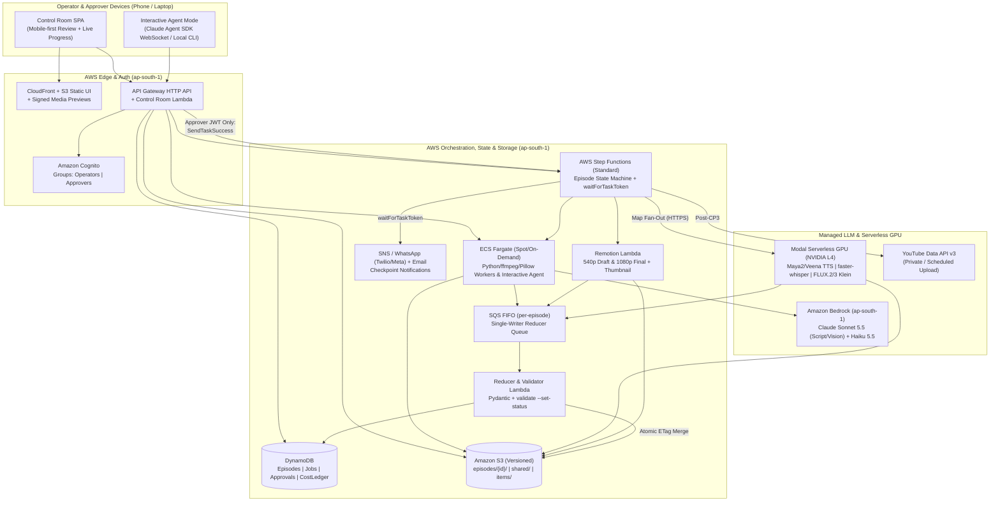
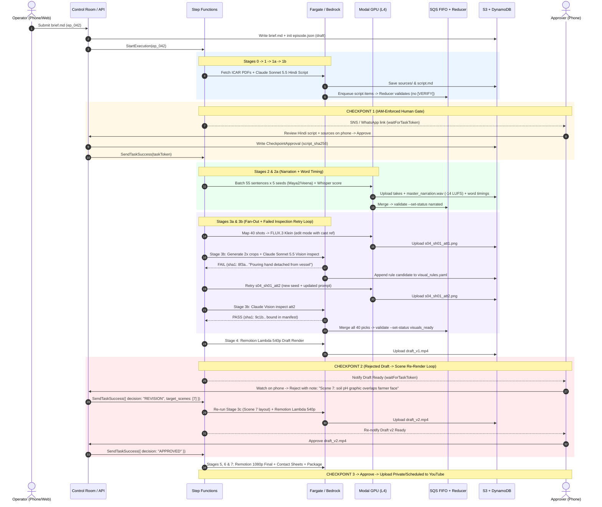

## A. Summary recommendation

Run orchestration, state, rendering, and LLM calls on **AWS (`ap-south-1` Mumbai)** using **Step Functions Standard**, **S3**, **DynamoDB**, **ECS Fargate**, **Remotion Lambda**, and **Amazon Bedrock (Claude Sonnet 5.5 / Haiku 5.5)**, while bursting CUDA audio/image workers (**Maya2 Native + Veena TTS, Whisper large-v3-turbo, FLUX.2/3 Klein**) to **Modal** serverless GPUs (NVIDIA L4, per-second billing, scale-to-zero).

This keeps ~90% of the stack inside AgriGate’s existing AWS account with near-zero idle cost (~$15/mo fixed AWS/domain overhead, plus $100/mo Remotion Automators license only if company headcount exceeds 3), cuts per-episode media runtime from ~90 min on the MacBook to ~3 min via parallel fan-out, and enforces all three human checkpoints via IAM-separated Cognito roles and Step Functions `waitForTaskToken` callbacks. Total monthly spend is **~$28/mo (≤3 staff) or ~$128/mo (4+ staff) at 12 episodes**, and **~$126–$226/mo at 60 episodes**, with **Claude API tokens** (specifically Stage 3b image inspection) as the dominant variable cost.

---

## B. Architecture diagram



---

## C. Service per job

All estimates below assume a **4-minute `long` episode** (~22 scenes, ~55 sentences, ~40 image shots × 1.5 attempts = 60 renders) in `ap-south-1` (Mumbai), bursting GPU work to Modal.

| Stage / Job | Cloud Service | Compute / GPU Size | Why this service | Rejected alternatives | Est. Cost / Episode |
| --- | --- | --- | --- | --- | --- |
| **0. New episode & source fetch** | ECS Fargate Task (triggered by Step Functions) + Bedrock | 0.5 vCPU, 1 GB RAM (~15 s) + Claude Haiku 5.5 | Needs Python CLI + `pypdf`/HTML scraper to fetch ICAR/gov PDFs and write `sources/` to S3; Fargate avoids Lambda package-size limits for PDF libs. | Lambda (layer bloat with `pypdf`/OCR); local Mac. | ~$0.01 |
| **1. Hindi script generation** | ECS Fargate + Amazon Bedrock (Claude Sonnet 5.5) | 0.5 vCPU, 1 GB RAM + Sonnet 5.5 (~35k in / 6k out tokens) | Sonnet 5.5 ($2/$10 per MTok) excels at grounded Hindi + delivery markup (`|`, `{warm}`) and strict source attribution. Prompt caching cuts repeated `sources/` PDF cost by 90%. | Opus 5.5 ($4/$20 — overkill for structured Hindi script); open LLMs (weaker Devanagari nuance & citation discipline). | ~$0.09 |
| **1a & 1b. Text normalize + `validate**` | AWS Lambda (Python 3.12) | 512 MB RAM (~1–2 s) | Pure Python Pydantic schema + `[VERIFY]` + file-existence gate; runs after every stage transition for pennies. | Dedicated container (unnecessary cold start). | <$0.001 |
| **CP 1. Script approval** | Step Functions `waitForTaskToken` + Control Room UI | $0 while waiting | Step Functions Standard pauses up to 1 year at zero idle compute cost; approver reviews Hindi script + cited source excerpts on phone. | Polling loop; Slack-only text approval (harder to read 22 scenes on phone). | <$0.001 |
| **2. Narration (N=5–6 takes + Whisper scoring + LUFS)** | **Modal** GPU Function (`maya2` + `veena` + `faster-whisper`) + Fargate audio join | **1× NVIDIA L4 (24 GB)** on Modal (~95 s total) + Fargate 1 vCPU (~10 s) | 3B Llama+SNAC TTS + `whisper-large-v3-turbo` fit easily in 24 GB VRAM; batching 55 sentences × 5 seeds on L4 ($0.000222/s = $0.80/hr) finishes in ~95 s vs 45 min on Mac. Fargate runs `ffmpeg` `-14 LUFS` stitch. | AWS EC2 `g6.xlarge` (2–4 min boot + spot interruptions); SageMaker Async (5+ min cold start); ElevenLabs (cannot run custom open-weight Maya2/Veena). | ~$0.03 |
| **2a. Word timing & alignment** | Modal L4 (reuses warm container) or Fargate CPU | L4 (~8 s) + 1 vCPU Python (~5 s) | Runs `faster-whisper` word timestamps on final stitched WAV + letter-by-letter Devanagari silence-snap alignment in Python. | Separate GPU call (piggybacking on Stage 2's warm L4 avoids cold start). | ~$0.005 |
| **3 & 3a. Cast & Images (40 shots × 1.5 attempts)** | **Modal** GPU Map Fan-Out (`FLUX.3 Image Klein` / `FLUX.2-klein-4B` via Diffusers) | **6× parallel NVIDIA L4 (24 GB)** (~75 s wall-clock; ~420 GPU-s total) | Modal `.map()` fans out 40 shots across 6 L4 containers in ~75 s (`$0.000222/s × 420s ≈ $0.093`), supporting reference-image edit mode for cast shots. | BFL Hosted API (~$0.03–$0.04/img × 60 = $2.10/ep — 20× costlier); RunPod Pods (idle billing). | ~$0.10 |
| **3b. Image inspection (mandatory SHA-1 gate)** | ECS Fargate (Pillow 2× crops + cast side-by-side) + **Bedrock Claude Sonnet 5.5 Vision** | 1 vCPU, 2 GB RAM (~15 s) + Sonnet 5.5 Vision (60 images × ~1,600 img tokens + 2× crops) | Strongest multimodal spatial/physics accuracy (hands, tool grip, poured material physics, crop stage); binds verdict to image SHA-1 and updates `visual_rules.yaml` on fails. | Open VLMs alone (already failed bake-off with 30% false-fail rate); Haiku 5.5 alone (miss rate on subtle physics/finger defects). | ~$0.38 |
| **3c. Graphics cues** | AWS Lambda (Python 3.12) | 512 MB RAM (~1 s) | Deterministic cue timing from Stage 2a word timestamps + Sonnet 5.5 prop fill. | Container task (overkill). | ~$0.005 |
| **4. Draft render (540p)** | **Remotion Lambda** (`ap-south-1`) | 2048 MB RAM, 2048 MB `/tmp`, ~25 chunks (~25 s wall-clock) | Renders 4-min 540p draft in ~25 s using bundled Devanagari fonts in S3 site bundle. | ECS Fargate single-container render (~1.5–2 min, slower iteration). | ~$0.03 |
| **CP 2. Draft watch & scene notes** | CloudFront signed URL + Control Room mobile player + Step Functions | $0 while waiting | Approver watches 540p MP4 on phone, taps scenes to leave notes; supports targeted `--scene N` re-entry. | YouTube unlisted upload (slow processing, leaks pre-approved drafts). | <$0.01 |
| **5. Final render (1080p H.264/AAC)** | **Remotion Lambda** (`ap-south-1`) | 3008 MB RAM, 4096 MB `/tmp`, ~40 chunks (~35 s wall-clock) | Parallel chunk rendering across 40 Lambdas finishes 4-min 1080p MP4 in ~35 s. | AWS MediaConvert (does not execute React/Remotion compositions). | ~$0.08 |
| **6. Automated + Vision QA Review** | ECS Fargate (`ffmpeg` + Pillow contact sheets) + Bedrock Sonnet 5.5 | 1 vCPU, 2 GB RAM (~20 s) + Sonnet 5.5 (~6 contact sheets) | Extracts frame every 2 s into contact sheets, runs LUFS/black-frame/freeze checks, and sends sheets to Sonnet 5.5 for `review.md`. | Manual-only review. | ~$0.04 |
| **7. Package & Thumbnail** | Remotion Lambda (`renderStill`) + Bedrock Haiku 5.5 | 2048 MB Lambda (~3 s) + Haiku 5.5 ($0.10/$0.50 MTok) | Renders 1280×720 thumbnail still and compiles `youtube.md` + synthetic-content disclosure. | Separate image model for thumbnail. | ~$0.005 |
| **CP 3 & YouTube Upload** | Step Functions `waitForTaskToken` + Upload Lambda | 512 MB RAM (~15 s) | Approver signs off on phone; Lambda uploads 400 MB MP4 from S3 to YouTube Data API v3 (`private`/`scheduled`). | Manual laptop download + browser upload. | <$0.01 |
| **Total Variable Compute + AI / Episode** |  |  |  |  | **~$0.78 / episode** *(~$1.05 with 1.5× CP2 re-renders)* |

---

## D. Orchestration, Claude's role and human checkpoints

### 1. Orchestration: AWS Step Functions (Standard Workflows)

* **Why Step Functions Standard over Temporal / LangGraph / Prefect:**
* **Zero infrastructure to patch or keep alive:** No Temporal server/Cassandra/Postgres cluster or self-hosted LangGraph worker fleet to maintain for a 1–2 person team.
* **Free, durable multi-day waits:** Standard workflows can pause up to **1 year** on `.waitForTaskToken` (Checkpoints 1, 2, and 3) with **zero compute charges** while waiting.
* **Native parallel fan-out & retries:** Inline/Distributed `Map` states fan out 40 image shots or 55 TTS sentences with exponential backoff (`IntervalSeconds: 5, BackoffRate: 2.0, MaxAttempts: 3`) and per-branch error catching.
* **Scene-level reruns (`--scene N`):** The state machine accepts an input payload `{ "episode_id": "ep_042", "start_stage": "images", "target_scenes": [4, 11], "force": true }`. Each stage checks idempotency hashes in `episode.json` and only recomputes dirty scenes/shots.
* **Future-proofing:** Adding a parallel branch after Checkpoint 2 for `shorts_recut` (9:16 Remotion render) or a `1–2s image-to-video` Modal step requires adding one state in CDK without changing worker contracts.


### 2. Where Claude Fits: Dual-Mode Execution (Unattended + Interactive)

Keep your existing Python CLI and markdown skills (`skills/*.md`), and run Claude in two complementary modes backed by **Amazon Bedrock in `ap-south-1**`:

1. **Unattended Production Mode (Default):**
* Each reasoning/vision stage runs as a deterministic step inside ECS Fargate invoking **Claude Sonnet 5.5** (or Haiku 5.5 for packaging) via the Anthropic/Bedrock Messages API with **Structured Outputs** (`json_schema` matching your Pydantic models) and scoped local tools (PDF fetcher in Stage 0, Pillow 2× cropper in Stage 3b).
* Your existing `skills/*.md` files are loaded as system prompts with **Prompt Caching** enabled (90% input token discount on repeated skill/rule instructions across shots).
* **Image Inspection (Stage 3b):** A Fargate worker generates a composite inspection sheet per attempt (1024px full image + 2× crops on hands/face/tool-contact zone + side-by-side cast reference) and calls Sonnet 5.5 Vision. Only `PASS` verdicts signed with the image's `sha1` advance the shot; `FAIL` verdicts append a concrete rule candidate to `shared/visual_rules.yaml` (queued for human approval) and trigger attempt `N+1` with a rewritten prompt.


2. **Interactive Co-Pilot Mode (On-Demand):**
* When an operator wants to brainstorm an angle, fix a stubborn scene prompt, or co-edit Hindi phrasing, they click **"Open Interactive Session"** in the Control Room (or run `agrigate-cli attach ep_042` from their Mac).
* This launches an on-demand **ECS Fargate task** running the **Claude Agent SDK** (the programmatic engine behind Claude Code), which syncs `s3://agrigate-prod/episodes/ep_042/` to local `/workspace` via `s5cmd` on startup and streams a web terminal/chat UI over WebSocket through API Gateway.
* When the operator finishes and clicks **"Save & Resume Pipeline"**, a shutdown hook syncs `/workspace` back to S3, runs `validate`, and signals Step Functions.


### 3. Hard-Enforced Human Checkpoints (Preventing Agent Self-Approval)

Approval is enforced at the **IAM + cryptographic signature level**, not prompt instructions:

1. **Separate IAM Execution Roles:**
* `agrigate-worker-role` (assumed by Fargate, Modal callbacks, and the Claude Agent SDK) has **explicitly denied** `states:SendTaskSuccess` on checkpoint ARNs and **no `dynamodb:PutItem` permission** on the `CheckpointApprovals` table. Even if prompted to "approve the script", the AWS API rejects the call with `AccessDenied`.
* `agrigate-approver-role` (assumed only by the Control Room API Lambda when the caller’s Cognito JWT contains `cognito:groups = ["Approvers"]`) holds `states:SendTaskSuccess` and `dynamodb:PutItem` on `CheckpointApprovals`.


2. **Hash-Bound Approval Records:**
* When an approver taps **Approve** on their phone, the API writes `{ episode_id, checkpoint: "CP1_SCRIPT", artifact_sha256, approver_email, cognito_sub, timestamp }` to `CheckpointApprovals` and calls `SendTaskSuccess`.
* `validate --set-status script_approved` verifies that a valid `CheckpointApprovals` record exists whose `artifact_sha256` matches the current `script.md` (or `draft.mp4` for CP2, `video.mp4` + `youtube.md` for CP3). Any post-approval edit invalidates the hash and automatically re-locks the gate.


---

## E. Data and storage

### 1. S3 Bucket Layout (`s3://agrigate-media-ap-south-1/`, Versioning Enabled)

```text
s3://agrigate-media-ap-south-1/
├── shared/
│   ├── cast/farmer_ramesh_v1.png            # Human-approved reference portraits
│   ├── brand/logo.svg, fonts/NotoSansDevanagari-*.ttf
│   ├── rules/visual_rules.yaml, pronunciation.yaml, config.yaml
│   └── remotion-bundle/v4.0.545/            # Pre-built Remotion site bundle for Lambda
└── episodes/
    └── ep_042/
        ├── brief.md
        ├── script.md
        ├── episode.json                     # Single source of truth (versioned)
        ├── log.md                           # Append-only audit log
        ├── youtube.md
        ├── sources/                         # Official ICAR / gov PDFs + README.md
        ├── audio/
        │   ├── takes/s01_u01_seed101.wav    # Content-addressed by hash(text+style+seed)
        │   ├── scenes/s01.wav               # Selected & trimmed scene WAVs
        │   └── master_narration.wav         # -14 LUFS master
        ├── images/
        │   ├── attempts/s01_sh01_att1.png   # Every attempt preserved
        │   ├── crops/s01_sh01_att1_grid.jpg # Full + 2x crop + cast ref sheet sent to Claude
        │   └── picks/s01_sh01.png           # Approved pick
        ├── render/
        │   ├── draft_v1.mp4                 # 540p draft
        │   ├── video.mp4                    # 1080p final (~400 MB)
        │   └── thumbnail.png
        ├── review/
        │   └── sheet_01.jpg, review.md
        └── items/                           # Ephemeral per-worker atomic output JSONs
            ├── audio/s01_u01.json
            └── shots/s01_sh01_att1.json

```

### 2. `episode.json` Concurrency Control (Single-Writer Reducer Pattern)

When 40 parallel image workers or 55 TTS workers finish concurrently, they **never** write directly to `episode.json`:

1. **Immutable Item Manifests:** Each worker writes its output blob (`s04_sh02_att1.png`) and a small result JSON (`items/shots/s04_sh02_att1.json` containing prompt, seed, SHA-1, inspection verdict) to S3, then pushes `{ episode_id, item_key }` to an **SQS FIFO queue** with `MessageGroupId = episode_id`.
2. **Single-Writer Reducer Lambda:** Configured with `BatchSize = 20` and `MaximumConcurrency = 1` per `MessageGroupId` (`episode_id`), the Reducer Lambda reads `episode.json` + its current S3 `ETag`, merges all queued item JSONs in memory, validates the merged object against the strict Pydantic schema (`extra="forbid"`), and writes `episode.json` back using **S3 Conditional Write (`IfMatch: current_etag`)**.
3. **Audit & History:** Because S3 Versioning is enabled on `episode.json`, every state transition is automatically preserved as an immutable S3 object version alongside `log.md`.

### 3. DynamoDB Index & Lifecycle Retention

* **DynamoDB Tables (On-Demand billing — pennies/month):**
* `Episodes` (`PK: episode_id`, `GSI1: status#updated_at`): Powers the Control Room status rail, live stage progress bars, and cost totals without listing S3.
* `CheckpointApprovals` (`PK: episode_id`, `SK: checkpoint#timestamp`): Immutable audit trail of human decisions and scene notes.
* `TopicBacklog` (`PK: crop_season`, `SK: priority#topic_id`): Ready for the planned crop-calendar & YouTube Analytics feedback loop.


* **S3 Lifecycle & CDN:**
* `episodes/*/audio/takes/*` and `episodes/*/images/attempts/*`: Transition to **S3 Glacier Instant Retrieval** after **30 days** (~80% storage savings while remaining immediately retrievable for audit/re-cuts).
* `episodes/*/items/*`: Expire after **14 days** (already merged into `episode.json`).
* `episodes/*/render/video.mp4`: Transition to **S3 Standard-IA** after **60 days** once published to YouTube.
* **CloudFront:** Serves the Control Room SPA and issues short-lived **CloudFront Signed URLs** (2-hour TTL) for `draft_v1.mp4`, `master_narration.wav`, and PNGs so approvers stream smoothly on mobile networks in India without public S3 buckets.


---

## F. Messaging and event flow



---

## G. Porting the Mac-only parts

### 1. Model-by-Model CUDA / Cloud Migration Matrix

| Component | Current Mac (MLX) | Cloud Runtime (NVIDIA CUDA) | License & Commercial Status | Numerical / Behavioral Risks & Parity Verification |
| --- | --- | --- | --- | --- |
| **Maya2 Native (Male TTS)** & **Veena (Female TTS)** | `mlx` on M5 unified memory (sequential sentence loop) | **PyTorch 2.5 + `transformers` / `vLLM` + `snac` 24kHz** in a Modal L4 container (`MayaResearch/maya2-native` OpenAI-compatible server + `maya-research/Veena`) | **Apache 2.0** for both `maya2-native` and `Veena` — unrestricted commercial use. | **Risks:** FP16/BF16 CUDA sampling vs MLX FP16/quantized kernels can subtly shift prosody, pause length, or SNAC codebook decoding at extreme temperatures.<br>

<br>**Parity test:** Run 50 canonical Hindi test sentences across 5 seeds on both Mac MLX and Modal L4; compare Whisper CER, pitch contour stats, and blind human MOS preference. |
| **Whisper `large-v3-turbo**` | `mlx-whisper` | **`faster-whisper` (CTranslate2 CUDA FP16)** + Python CTC/silence-snap aligner on the same L4 container | **MIT License** (Whisper weights + `faster-whisper`). | **Risks:** CTranslate2 beam-search rounding can shift word boundary timestamps by ±20–40 ms vs `mlx-whisper`.<br>

<br>**Parity test:** Run Stage 2a alignment on 3 historical episodes; verify ≥98% identical best-take picks and caption word-highlight timestamps within ±50 ms (1–2 frames at 30fps). |
| **FLUX.2 [klein] 4B** & **FLUX.3 Image Klein (5.6B)** | `mflux` (4-bit / q8 on 16 GB M5) | **Hugging Face `diffusers` (BF16 / FP8 via `torchao`)** on Modal L4 (24 GB) or L40S (48 GB) | **`FLUX.2-klein-4B`:** **Apache 2.0**.<br>

<br>**`FLUX.3 Image Klein`:** BFL **FLUX Kommunity License v1.0** / BFL commercial open-weights tier (`bfl.ai/open-weights`) — verify AgriGate’s revenue/usage falls within the community cap or purchase BFL's self-serve commercial license before shipping. | **Risks:** Moving from 4-bit/q8 MLX to BF16/FP8 CUDA changes noise trajectories (deterministic seeds will not produce pixel-identical images across MLX and CUDA, though prompt adherence and edit-mode cast consistency improve at full BF16 precision).<br>

<br>**Parity test:** Re-run your 36-prompt blind bake-off suite + 10 cast-reference edit shots on Modal BF16; require ≥33/36 Claude Vision pass rate and verified cast face similarity before switching `config.yaml` default. |

### 2. New Commercially Licensed Image Models Unlocked Beyond 16 GB VRAM

Once freed from the MacBook’s 16 GB RAM ceiling, an **L40S (48 GB, $0.000542/sec = $1.95/hr on Modal)** lets you benchmark three strong commercially viable upgrades behind the same `generate_shot()` interface:

1. **`Tongyi-MAI/Z-Image-Turbo` (6B, Apache 2.0):** Already scored 10/12 in your q6 bake-off; running unquantized **BF16** (~14–16 GB VRAM) eliminates quantization artifacts on skin tones and crop textures.
2. **`FLUX.2 [dev]` / `FLUX.3 Image` (full-size weights via BFL commercial self-serve license):** Higher spatial coherence for complex multi-person Indian farm scenes and farm implements than 4B–5.6B Klein variants.
3. **Future Stage 3d (1–2 s Image-to-Video):** **Wan 2.2 (14B, Apache 2.0)** or **LTX-Video (Apache 2.0)** on Modal L40S/A100 to animate subtle tractor/irrigation motion on hero shots.

---

## H. Security, licenses and operations

### 1. Secrets & IAM Least Privilege

* **Secrets Management:** Store Anthropic API keys (if bypassing Bedrock), Hugging Face read token (for gated BFL repositories), YouTube OAuth2 refresh tokens, and WhatsApp webhook tokens in **AWS Secrets Manager** (`ap-south-1`). Inject into Modal via Modal Secrets synced from AWS Secrets Manager, and into Fargate via ECS task secret references.
* **Strict Role Separation:**
* `agrigate-worker-role`: Scoped `s3:GetObject`/`PutObject` on `s3://agrigate-media-ap-south-1/episodes/*` (read-only on `shared/*`), `bedrock:InvokeModel` for Claude Sonnet/Haiku, `sqs:SendMessage` to the Reducer queue. **Explicit `Deny` on `states:SendTaskSuccess` and `CheckpointApprovals` writes.**
* `agrigate-approver-role`: Used exclusively by the authenticated Control Room API when `cognito:groups` includes `Approvers`.
* **Control Room Auth:** **Amazon Cognito User Pool** with MFA enabled (`Operators` group vs `Approvers` group). Even in a 2-person team, require separate `Approver` login/MFA to sign off checkpoints.


### 2. Licensing Compliance Checklist

* **Remotion License (Updated Nov 20, 2026):**
* If AgriGate as a whole legal entity has **≤3 people**, Remotion’s **Free License** covers unlimited commercial use ($0).
* Because AgriGate already operates other AWS products and likely employs **4+ people total**, cloud rendering on Remotion Lambda requires **Remotion for Automators** (**$0.01/render, $100/month minimum**, which includes 10,000 renders/month and covers developers working on automation without extra Creator seats).


* **Model & Library Licenses:**
* `Maya2 Native` (Apache 2.0), `Veena` (Apache 2.0), `Whisper large-v3-turbo` / `faster-whisper` (MIT), `FLUX.2-klein-4B` (Apache 2.0), `Z-Image-Turbo` (Apache 2.0), `Noto Sans Devanagari` (SIL OFL 1.1).
* `FLUX.3 Image Klein`: Commercial use allowed under BFL's open-weights license terms (`bfl.ai/open-weights`) — confirm revenue-cap eligibility or activate BFL’s self-serve commercial license before monetizing videos.
* **Synthetic Content & Voice Guardrails:** Keep only synthetic reference portraits in `shared/cast/` and stock Maya2/Veena speaker embeddings (no real-person voice cloning); auto-inject YouTube’s `containsSyntheticMedia` disclosure flag via YouTube Data API v3 in Stage 7.


### 3. Infrastructure as Code, CI/CD & Cost Observability

* **IaC & CI/CD:** Define all AWS resources in **AWS CDK (Python)** (single stack, ~350 lines, matches your Python team) and Modal apps in `infra/modal_workers.py`. GitHub Actions runs `pytest` (Pydantic schema + text normalizer + validator tests), `cdk deploy`, `modal deploy`, and `npx remotion lambda sites create` whenever `remotion/` changes.
* **Per-Episode & Per-Stage Cost Ledger:** Every Bedrock response (`usage.input_tokens`, `usage.output_tokens`, `cache_read_input_tokens`), Modal invocation (`execution_seconds × gpu_rate`), and Remotion Lambda render (`render_id` estimated cost) writes an itemized record to DynamoDB `CostLedger` (`PK: episode_id`, `SK: stage#timestamp`). The Control Room displays live spend per episode alongside **AWS Budgets** and **Modal Spend Alerts** (thresholds at $50, $150, $250/mo).

---

## I. Cost model

Assumptions: 4-minute `long` episodes (~22 scenes, ~40 shots × 1.5 attempts), 1.3× average Draft→CP2 revision cycles, `ap-south-1` AWS pricing, Modal starter plan ($0/mo base, $30/mo free credits included; we show **gross** cost before free tiers so numbers scale honestly), and Amazon Bedrock / Anthropic Claude Sonnet 5.5 ($2/$10 per MTok, $0.20/MTok cache read).

### 1. Fixed Monthly Costs

| Item | 12 Episodes / Mo | 60 Episodes / Mo | Notes |
| --- | --- | --- | --- |
| **Remotion for Automators License** | $0 *(≤3 staff)* / **$100.00** *(4+ staff)* | $0 *(≤3 staff)* / **$100.00** *(4+ staff)* | $100/mo minimum covers up to 10,000 cloud renders. |
| **AWS Base (S3 storage ~15–60 GB, DynamoDB, Cognito, CloudWatch, Secrets Manager)** | ~$4.50 | ~$7.50 | Zero NAT Gateway ($40.88/mo saved by using public-subnet Fargate + S3/DynamoDB VPC endpoints); zero idle ALB. |
| **CloudFront + Route53 + Control Room API** | ~$1.50 | ~$3.00 | First 1 TB/mo CloudFront data transfer out is free on AWS Free Tier. |
| **Modal Platform Fee** | $0.00 | $0.00 | Starter plan is $0/mo + compute (includes $30/mo free credit). |
| **Total Fixed Cost / Month** | **$6.00** *(≤3 staff)* / **$106.00** *(4+ staff)* | **$10.50** *(≤3 staff)* / **$110.50** *(4+ staff)* |  |

### 2. Variable Cost per Episode & Monthly Totals

| Stage / Category | Cost / Episode | 12 Episodes / Mo | 60 Episodes / Mo | Dominant Driver |
| --- | --- | --- | --- | --- |
| **Claude Vision (Stage 3b image inspection + Stage 6 contact sheets)** | **$0.42** | $5.04 | $25.20 | **#1 variable cost:** ~60 inspection grids (full + 2× crops + ref) + 6 contact sheets on Sonnet 5.5 Vision. |
| **Claude Text (Stage 0/1 Hindi script + Stage 3a scene specs + Stage 7 metadata)** | **$0.13** | $1.56 | $7.80 | Sonnet 5.5 with prompt caching on `sources/` & `skills/*.md`. |
| **Modal Serverless GPU (TTS Maya2/Veena + Whisper + FLUX.2/3 Klein)** | **$0.14** | $1.68 | $8.40 | ~620 L4 GPU-seconds/episode at $0.000222/s (mostly absorbed by Modal's $30/mo free credit). |
| **Remotion Lambda Compute (1.3× 540p drafts + 1× 1080p final + thumbnail)** | **$0.12** | $1.44 | $7.20 | AWS Lambda GB-seconds in `ap-south-1` (first 400k GB-s/mo free). |
| **AWS ECS Fargate + Lambda + S3 Requests** | **$0.04** | $0.48 | $2.40 | Short CPU bursts for `ffmpeg` LUFS, contact sheets, and interactive sessions. |
| **Total Variable Cost** | **$0.85 / ep** | **$10.20** | **$51.00** |  |
| **Grand Total (Fixed + Variable, before free credits)** | — | **$16.20** *(≤3 staff)*<br>

<br>**$116.20** *(4+ staff)* | **$61.50** *(≤3 staff)*<br>

<br>**$161.50** *(4+ staff)* | **Remotion license** dominates fixed cost (if 4+ staff); **Claude Vision inspection** dominates variable cost (~50% of per-episode spend). |

*(Adding 20–30 Shorts/month derived from existing episodes adds ~$0.15/Short ≈ $3–$5/mo.)*

---

## J. Phased migration plan

Each phase leaves the pipeline **100% shippable** while incrementally retiring the MacBook Air:

| Phase | What Moves to Cloud | What Still Runs on MacBook | Acceptance Test (Must Pass Before Next Phase) |
| --- | --- | --- | --- |
| **Phase 1: Cloud State, Storage & Remotion Render (Week 1)** | S3 bucket + versioning, DynamoDB `Episodes` + `CostLedger`, Reducer Lambda, Remotion Lambda bundle (`ap-south-1`). Add `storage: "s3"` and `renderer: "remotion_lambda"` options in `config.yaml`. | Claude Code session, TTS, Whisper, FLUX image gen, Control Room UI. | 1. Render 1 full 4-min episode at 540p and 1080p on Remotion Lambda; verify Devanagari matras/ligatures match local Mac render frame-for-frame.<br>

<br>2. Simulate 20 concurrent S3 item writes and confirm zero lost updates in `episode.json`. |
| **Phase 2: Offload Heavy GPU Workers to Modal (Weeks 2–3)** | Deploy `maya2-native`, `veena`, `faster-whisper`, and `FLUX.2/3 Klein` (incl. reference-image edit mode) on Modal L4. Implement `backend: "modal"` behind existing `synthesize()` and `generate_shot()` interfaces. | Claude Code orchestration, image inspection, checkpoints, local Control Room. | 1. **Audio A/B Parity:** Generate 50 Hindi sentences × 5 seeds on Modal vs Mac; confirm Whisper CER delta ≤0.5% and blind listener pass.<br>

<br>2. **Image A/B Parity:** Run 36-prompt bake-off + 10 cast-edit shots on Modal BF16; confirm ≥33/36 Claude Vision pass rate and total episode GPU wall-clock <4 min. |
| **Phase 3: Control Room Web App & Phone Checkpoints (Week 4)** | Host Control Room on CloudFront + API Gateway + Cognito (`Operators` / `Approvers`), Step Functions Standard workflow, `waitForTaskToken` checkpoints, SNS/WhatsApp notifications, and YouTube Data API upload. | Interactive Claude Code CLI (pointed at S3 + Step Functions API). | 1. End-to-end episode completed with **approver using only a smartphone** on mobile data to review script, watch 540p draft, reject 1 scene, approve v2, and trigger private YouTube upload.<br>

<br>2. Verify `agrigate-worker-role` gets `AccessDenied` when attempting `SendTaskSuccess`. |
| **Phase 4: Cloud Claude Execution & Unattended Mode (Week 5)** | Move Stages 0, 1, 3b, 6, 7 to ECS Fargate + Amazon Bedrock (Claude Sonnet 5.5) for unattended runs; deploy on-demand Claude Agent SDK container for interactive co-editing. | **Nothing required** (MacBook becomes an optional thin client). | 1. Run 2 episodes end-to-end with the MacBook closed from `brief.md` to `youtube.md`, pausing only at Checkpoints 1–3.<br>

<br>2. Confirm per-episode cost in `CostLedger` matches actual AWS + Modal billing within ±10%. |

---

## K. Risks and open questions

1. **Company Headcount for Remotion License:** Does AgriGate as a whole company employ **≤3 people** or **4+ people**? If ≤3 total, you legally qualify for Remotion’s $0 Free License and save $1,200/year; if 4+, you must budget the $100/mo Remotion for Automators plan.
2. **`FLUX.3 Image Klein` Commercial Terms:** `FLUX.3 Image Klein` (released Oct 2026) ships under BFL’s FLUX Kommunity License v1.0 / commercial open-weights tier (`bfl.ai/open-weights`). Confirm AgriGate’s revenue/usage fits the self-serve commercial terms, or fall back to **Apache 2.0 `FLUX.2-klein-4B**` / **`Z-Image-Turbo`** if you want zero commercial-cap ambiguity.
3. **Maya2 Native / Veena CUDA Batching Throughput:** Both models are recent late-2026 releases (`MayaResearch/maya2-native` Oct 2026; `maya-research/Veena`). Verify whether their official PyTorch/vLLM servers support continuous batching across 50+ prompts natively or need a lightweight batched wrapper around `transformers` + `snac` so GPU utilization stays >70% on L4.
4. **Amazon Bedrock `ap-south-1` Quota:** Newly enabled accounts in Mumbai (`ap-south-1`) sometimes start with conservative tokens-per-minute (TPM) quotas for Sonnet 5.5 Vision. Request a TPM quota increase (e.g., to 200k TPM) during Phase 1 so 60 parallel image inspections don't throttle.
5. **WhatsApp Business Notification Approval:** If you want rich WhatsApp messages (with thumbnail + one-tap approval links) instead of email/SMS, Meta Business verification for a WhatsApp Business API sender takes ~1–2 weeks; start with Amazon SES email + SMS/Telegram/Slack on Day 1 while Meta approves the sender ID.

---

## L. Sources consulted

| Source | URL | Date | Confidence |
| --- | --- | --- | --- |
| **Remotion License & Pricing (Official Docs)** | [https://www.remotion.dev/docs/license/pricing](https://www.remotion.dev/docs/license/pricing) | Updated Nov 20, 2026 | **High** (verified ≤3-person Free tier, $100/mo Automators minimum, $0.01/render) |
| **Remotion Lambda Docs & Limits** | [https://www.remotion.dev/docs/lambda](https://www.remotion.dev/docs/lambda) & [https://www.remotion.dev/docs/lambda/limits](https://www.remotion.dev/docs/lambda/limits) | Checked Nov 22, 2026 | **High** (verified 10 GB `/tmp`, 15-min timeout, 1,000 default concurrency, Automators requirement) |
| **Remotion Pricing & AWS Lambda Cost Breakdown** | [https://www.wireflow.ai/blog/remotion-pricing](https://www.wireflow.ai/blog/remotion-pricing) | Oct 20, 2026 | **High** (verified ~$0.017–$0.021 per 1-min 1080p render + S3/transfer rates) |
| **Modal Serverless GPU Pricing** | [https://modal.com/pricing](https://modal.com/pricing) & [https://www.spheron.network/blog/modal-gpu-pricing-2026-per-second-billing/](https://www.spheron.network/blog/modal-gpu-pricing-2026-per-second-billing/) | Jul 14 – Nov 2026 | **High** (verified L4 at $0.000222/s = $0.80/hr, L40S at $0.000542/s = $1.95/hr, $0 Starter + $30/mo credits, 1.5–1.75× region multiplier) |
| **Anthropic Claude API Pricing & Sonnet 5.5** | [https://platform.claude.com/docs/en/about-claude/pricing](https://platform.claude.com/docs/en/about-claude/pricing) & [https://www.anthropic.com/claude-sonnet-5-5](https://www.anthropic.com/claude-sonnet-5-5) | Sep 28 – Nov 2026 | **High** (verified Sonnet 5.5 at $2/$10 MTok, Haiku 5.5 at $0.10/$0.50 MTok, 0.1× prompt cache read) |
| **Amazon Bedrock India (`ap-south-1`) Claude Availability** | [https://aws.amazon.com/blogs/machine-learning/amazon-bedrock-expands-claude-model-availability-to-india-cross-region-inference/](https://aws.amazon.com/blogs/machine-learning/amazon-bedrock-expands-claude-model-availability-to-india-cross-region-inference/) | Sep 29, 2026 | **High** (verified in-country `ap-south-1` / `ap-south-2` support) |
| **Claude Agent SDK & Remote Sessions on AWS** | [https://aws.amazon.com/blogs/machine-learning/extend-claude-code-to-remote-sessions-on-amazon-bedrock-agentcore-with-security-controls/](https://aws.amazon.com/blogs/machine-learning/extend-claude-code-to-remote-sessions-on-amazon-bedrock-agentcore-with-security-controls/) | Nov 6, 2026 | **High** (verified containerized Claude Agent SDK / remote microVM architecture) |
| **Black Forest Labs `FLUX.3 Image Klein` & `FLUX.2-klein-4B**` | [https://bfl.ai/blog/flux-3-image-klein](https://bfl.ai/blog/flux-3-image-klein) & [https://huggingface.co/black-forest-labs/FLUX.2-klein-4B](https://huggingface.co/black-forest-labs/FLUX.2-klein-4B) | Apr 6 – Oct 17, 2026 | **High** (verified Diffusers/ComfyUI support, 5.6B edit weights, Apache 2.0 on FLUX.2-klein-4B, BFL license on FLUX.3 Klein) |
| **Maya Research `maya2-native` & `Veena` TTS** | [https://github.com/MayaResearch/maya2-native](https://github.com/MayaResearch/maya2-native) & [https://huggingface.co/maya-research/Veena](https://huggingface.co/maya-research/Veena) | Oct 25 – Nov 19, 2026 | **Medium–High** (verified Apache 2.0 license, Llama + 24kHz SNAC architecture, OpenAI-compatible server; CUDA batch throughput needs Phase 2 benchmark) |
| **AWS Step Functions & `ap-south-1` Pricing** | [https://aws.amazon.com/step-functions/pricing/](https://aws.amazon.com/step-functions/pricing/) & [https://zenocloud.io/blog/aws-cost-india/](https://zenocloud.io/blog/aws-cost-india/) | Aug 31 – Nov 19, 2026 | **High** (verified $0.025/1k transitions, 4,000 free/mo, $40.88/mo Mumbai NAT Gateway cost avoided) |